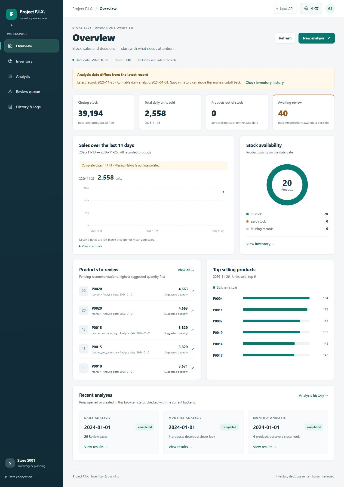
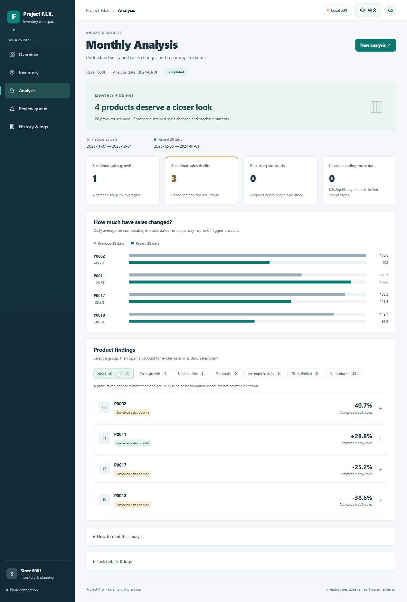

# Project F.I.X. — Forecasting & Inventory Exceptions

**MAIE 6000C · Group 5**

Project F.I.X. helps inventory planners turn retail observations into demand forecasts, replenishment recommendations, and reviewable exceptions. Its English and Simplified Chinese dashboard brings stock, sales, analysis findings, and pending decisions into one workspace.

[Quick start](#quick-start-local-model-demo-on-windows) · [Features](#what-you-can-do) · [Data and dates](#dates-data-sources-and-decisions) · [Connection modes](#local-hosted-and-mock-modes) · [Documentation](#documentation)

The current scope is one store, **S001**, and its 20 products. The system uses the supplied retail inventory dataset, with recorded sales as the demand proxy and simulated supplier lead times. The dataset's `Demand Forecast` column is retained as an offline reference and is excluded from model inputs.

## What you can do

| Page | Use it to |
| --- | --- |
| **Overview** (`#/overview`) | Check closing stock, daily sales, zero-stock products, pending reviews, a 14-day sales chart, stock availability, and recent analysis summaries. This is the default landing page. |
| **Inventory** (`#/inventory`) | Browse saved observations by date, compare stock and sales, filter zero-stock products, and inspect automatic settlement details. |
| **Analysis** (`#/analysis`) | Run Daily or Monthly analysis, read the conclusion first, then inspect charts, product evidence, and task details. |
| **Review queue** (`#/exceptions`) | Inspect replenishment and anomaly cases, then approve, adjust, reject, or resolve them as appropriate. |
| **History & logs** (`#/logs`) | Reopen analyses recorded in this browser, inspect browser diagnostics, or query and export backend execution logs. |

<details open>
<summary>Overview screenshot — local example data</summary>



</details>

### Daily forecasting and Monthly analysis

| | Daily analysis | Monthly analysis |
| --- | --- | --- |
| Main question | Which products may need replenishment? | Which sales trends and stockout patterns need attention? |
| Method | Trained LightGBM model predicts cumulative demand over each selected product's supplier lead time; daily anomaly checks provide additional context. | Rule-based diagnostics compare the recent 28 days with the previous 28 days across all 20 products. |
| Output | P50/P90 demand estimates, suggested replenishment, review cases, and supporting evidence. | Persistent sales growth/decline, recurring or prolonged stockouts, comparison bars, and expandable daily sales charts. |
| Data coverage | Complete cutoff-day snapshots for all 20 products; selected forecast products need 29 consecutive dates. The trained model requires a cutoff on or after `2023-09-01`. | Each product needs 56 consecutive observations for complete checks. Missing history and stock-limited comparisons are reported separately. |
| Availability | Live backend or the synthetic Daily demo. | Live backend only; disabled in mock mode. |

P50 is the median cumulative demand estimate; P90 is a higher coverage estimate over the same lead-time horizon. **Monthly analysis examines historical observations; it does not forecast the next 30 days or create replenishment review cases.** Sales comparisons use matched weekdays with positive stock in both periods.

<details open>
<summary>Monthly analysis screenshot — local example data</summary>



</details>

### Dates, data sources, and decisions

- **Dates are selected automatically.** For a new live analysis, the UI uses the API's newest runnable daily cutoff when available, falling back to the newest snapshot date. The runnable cutoff requires a complete 29-day store history and the model's minimum cutoff date. Both analysis modes use this date selection; Monthly still checks its own 56-day coverage. The API can reject requests without the required inputs.
- **Latest data and analysis cutoff can differ.** A new or partial record does not fill earlier gaps. Saved runs retain their original date. Do not interpret an older cutoff as proof that no newer records exist.
- **Charts preserve missing data.** Missing observations are left blank rather than converted to zero or interpolated. Monthly product charts read the current saved records for that period; later corrections may differ from the frozen analysis evidence.
- **History has two scopes.** The recent-analysis list and analysis history use this browser's retained activity records (up to 300 events), not a shared server-wide run index. Live task details and results are retrieved from the configured backend.
- **Inventory settlement is simulated.** By default, the worker posts simulated sales and receipts at **22:00, Asia/Shanghai**. Sales are capped at opening stock, and receipts replenish the remaining balance to the forecast target. With insufficient recent model history, settlement can use the explicitly labelled historical baseline. It does not backfill gaps predating its initial schedule. See the [daily inventory guide](docs/daily-data-entry-zh.md).
- **Reviews are advisory.** Running an analysis or recording a review does not place an order or change stock. The separate inventory settlement process does update simulated inventory and daily records.

## Currently works: local integration

**The documented local demo uses real backend services and a trained model.** Running locally describes where the services run; it does not mean the API is mocked. With the startup instructions below, the dashboard calls FastAPI, a separate worker calls the LightGBM service, and SQLite stores the workflow records by default. A separate mock mode remains available for interface demonstrations.

- Import daily snapshots through the public API and retain their source references.
- Submit a Daily analysis request and follow its persisted Run and Job states.
- Submit a Monthly analysis and inspect historical sales and stockout findings for all 20 products.
- Run the versioned LightGBM model asynchronously through a separate worker.
- View cumulative lead-time P50/P90 forecasts, replenishment quantities, and result provenance.
- Review replenishment and unusual-demand cases, including combined cases.
- Query backend application logs by task, request, service, and time, and export matching records.

Earlier local acceptance evidence is linked under [Verification and milestone history](#verification-and-milestone-history). It describes the tested revision and workflow, rather than a fixed date to select in today's UI.

The dashboard communicates with the public API. The worker calls the private AI service and saves results for subsequent retrieval. Detailed component boundaries and data flow belong in the architecture document linked below.

## Documentation

Each required document has a separate purpose; this README is the project entry point and setup guide.

| Document | Purpose |
| --- | --- |
| [System architecture](docs/architecture.md) | Components, architecture diagrams, data flow, and design decisions. |
| [Operations guide](docs/operations.md) | Running, monitoring, troubleshooting, and operating the system. |
| [Week 07 milestone](submissions/week07/README.md) | Demonstrated system path, milestone evidence, current status, remaining work, risks, and reproduction instructions. |

Existing supporting documentation:

- [Local integration and startup guide — Chinese](docs/local-integration-zh.md)
- [Railway deployment guide — Chinese](docs/railway-deploy-zh.md)
- [Public API contract](docs/frontend-api-contract.md) and [backend logs contract](docs/backend-logs-contract.md)
- [AI model documentation](ai/README.md)
- [Original Week 04 architecture reference](docs/w04-reference/docs/architecture.md)

## Technology overview

| Layer | Implementation |
| --- | --- |
| Dashboard | React, Vite, hash-based routing, and SVG/CSS charts |
| Public API | Python and FastAPI |
| Background processing | Separate polling worker |
| Forecasting | LightGBM quantile model, `s001-global-q-v1` |
| Persistence | SQLite by default; PostgreSQL adapter and versioned SQL migrations available |
| Deployment | GitHub Pages for the static frontend; Dockerfiles and Railway configuration guidance for backend services |

## Quick start: local model demo on Windows

### Prerequisites

- Git.
- Node.js 22.12 or newer in the Node 22 release line, with npm.
- Python 3.12 and the Windows Python launcher (`py`). Python 3.12.10 was used for the local integration checks.
- Windows PowerShell, with ports **5174**, **8000**, and **8001** available.

The following commands start the real local stack and use the default SQLite database. Leave `FIX_DATABASE_URL` unset for this setup. The API, worker, and AI service must all be running; opening only the frontend does not start them. The supplied start/stop scripts are Windows-specific; hosted deployment is documented separately.

| Service | Default address |
| --- | --- |
| Dashboard | [Overview](http://127.0.0.1:5174/FIX_dashboard/#/overview) |
| Public API | `http://127.0.0.1:8000` |
| Private AI service | `http://127.0.0.1:8001` |

The worker has no browser-facing port. The UI chooses its analysis date from stored coverage; the historical Week 07 date is not a setup requirement.

### 1. Get the repository and install dependencies

```powershell
git clone https://github.com/ShawnZhang0318/FIX_dashboard.git
cd FIX_dashboard
npm ci
py -3.12 -m venv .venv-model
.\.venv-model\Scripts\python.exe -m pip install -r ai/requirements-dev.txt
```

For an existing clean checkout, run `git pull --ff-only origin main`; run `npm ci` again if dependency files changed.

The repository includes the model artifacts and source CSV required for the demo. Keep their original bytes intact because the importer and model loader verify checksums.

### 2. Start the services

```powershell
$env:VITE_BASE_PATH = '/FIX_dashboard/'
.\scripts\start-local-demo.ps1
```

Setting the base path keeps the local preview URL consistent with the startup script. The script builds the dashboard and starts the public API, private AI service, worker, and frontend preview.

Confirm readiness before importing data:

```powershell
Invoke-RestMethod http://127.0.0.1:8001/health/ready
Invoke-RestMethod http://127.0.0.1:8000/health/ready
```

Both requests should succeed. The API readiness check also requires a current worker heartbeat. If a service is still starting, wait and repeat the checks; a process launch message alone does not confirm readiness.

### 3. Import the data

Choose one dataset per local database. For the **November 28 demo**, start the services in a fresh checkout with an empty local database, then import the demo snapshots.

```powershell
.\.venv-model\Scripts\python.exe -m local_backend.import_csv --calendar-replay
```

The [demo dataset](data/demo/s001-calendar-2026-11-28.json.gz) contains **14,640 snapshots** for 20 products on 732 consecutive dates, from **2024-11-27 through 2026-11-28**. The original 2026-11-25 simulation appears on November 28 and the original 2024-01-01 data on November 27. Each earlier recorded day moves back one more day. Quantities are preserved and every snapshot is labelled as simulated, with its original date and source in `source_reference`. A fresh import gives a Daily analysis cutoff of **2026-11-28**.

For the **historical dataset** used by the Week 07 and Week 13 fixed-date acceptance script, import the original CSV into a separate local database.

```powershell
.\.venv-model\Scripts\python.exe -m local_backend.import_csv
```

The importer sends **14,620 S001 observations** through the public API in bounded batches. Re-running it verifies and skips identical existing observations; conflicting records are rejected rather than overwritten. The supplied CSV covers **2022-01-01 through 2024-01-01**; importing it does not generate observations through the current calendar date.

Inspect saved coverage before running an analysis:

```powershell
Invoke-RestMethod 'http://127.0.0.1:8000/snapshots/latest?store_id=S001'
```

`snapshot_date` is the newest stored record date; `cutoff_date` is the newest date with complete runnable Daily coverage. Pulling code does not update either a local database or a hosted database. Use the appropriate data import or settlement workflow for the backend you configured.

### 4. Open the dashboard

1. Open the [local Overview](http://127.0.0.1:5174/FIX_dashboard/#/overview). Check the data date, coverage notice, stock, sales, and pending reviews.
2. Choose **New analysis**, then **Daily analysis** or **Monthly Analysis**. Check the automatically selected analysis date before submitting.
3. For **Daily**, choose **Run Daily Analysis**, inspect stock versus cumulative demand, and open a review case from the product action list.
4. For **Monthly**, choose **Run Monthly Analysis**, inspect the conclusion and period comparison, then filter and expand products to view the evidence and daily sales chart. Missing or stock-limited checks are not counted as normal.
5. Open **Task details & logs** for Run/Job identifiers and **View task logs** for the associated backend events. Use **History & logs** to reopen tasks recorded in this browser.

By default, business records and collected application logs persist in `.local-integration/fix.sqlite3`. Stopping and restarting the services preserves them. Runtime data and local environments are excluded from Git.

### 5. Stop or restart

```powershell
.\scripts\stop-local-demo.ps1
```

To restart, repeat step 2 in the project directory. Do not start a second copy while the recorded services are running. Data import is only needed for a new database or missing source records.

### Startup troubleshooting

- **A port is occupied:** the startup script stops before launching services. Stop this project's recorded services with the stop script when appropriate; do not terminate an unrelated process. The script uses fixed ports, so changing the browser URL alone will not move the API.
- **The API was deliberately started on another port:** configure API clients consistently. A loopback-only override such as `http://127.0.0.1:5174/FIX_dashboard/?api=http%3A%2F%2F127.0.0.1%3A8010#/overview` points the UI to an already-running API on 8010. Import into it with `python -m local_backend.import_csv --api http://127.0.0.1:8010` using the project virtual environment. Keep the worker on the same database.
- **The preview is blank or assets fail to load:** build with `VITE_BASE_PATH=/FIX_dashboard/` as shown above, restart the preview, and reload the matching `/FIX_dashboard/` URL. Vite defaults to `/` when the base path is unset.
- **Analysis shows an older date or rejects missing snapshots:** inspect `/snapshots/latest` and Inventory history. Add the required observations; changing the displayed date cannot repair missing history.

## Local, hosted, and mock modes

| Mode | Data and processing | Verification status |
| --- | --- | --- |
| Local real-model integration | Actual HTTP API, separate worker, trained LightGBM model for Daily forecasts, Monthly diagnostics, and SQLite persistence by default | Historical local acceptance is linked below. Verify the current revision and configured data when reproducing it. |
| Mock interface demo / default static preview | Synthetic fixtures and browser storage; no model inference or server database; Monthly is disabled | Useful for interface/workflow previews; not backend integration evidence. |
| Railway online fallback / hosted integration | Intended hosted path: frontend to public API, shared PostgreSQL for API/worker, and worker to private AI | Listed as an online fallback in the milestone. Cloud acceptance is partial; deployment availability does not establish a verified end-to-end hosted workflow. |

The [GitHub Pages preview](https://shawnzhang0318.github.io/FIX_dashboard/) uses mock mode with the repository's default static configuration unless a hosted API URL is supplied. GitHub Pages itself hosts no Python services or database.

The integrated dashboard's [runtime configuration](public/runtime-config.js) selects `live` mode and `http://127.0.0.1:8000` when opened on `127.0.0.1` or `localhost`. If that API is unavailable, requests fail; the app does not automatically substitute mock predictions. For a hosted frontend, set `VITE_FIX_API_URL` at build time or configure a hosted public API URL in the runtime settings. The **Local API**, **Live API**, and **Mock demo** badges describe the selected connection mode, not a health check or the backend's database type.

Backend settings such as `FIX_DATABASE_URL`, `FIX_AI_URL`, and `FIX_ALLOWED_ORIGINS` belong in the relevant service environments; database credentials must never be placed in browser configuration. API and worker must use the same database configuration. Local SQLite and a hosted PostgreSQL database remain separate unless you explicitly configure the backend connection; a Git pull does not synchronize their records. The startup script inherits process environment variables and does not automatically load arbitrary local `.env` files.

### Hosted deployment status

The team lists [the Railway site](https://fixdashboard-production.up.railway.app/) as an **online fallback** in the milestone document. Hosted acceptance remains recorded as partial: a deployed frontend does not establish a complete database, worker, model, review, and log workflow. This README update does not claim a new hosted acceptance run or that a hosted site is serving the latest commit.

Follow the [Railway guide](docs/railway-deploy-zh.md) and record the tested Git SHA, test date, service configuration, and evidence of:

- API and AI readiness, with a current worker heartbeat.
- An accepted request creating persisted Run/Job records in PostgreSQL.
- The worker completing real inference and saving results.
- A saved review that can be retrieved again, without changing inventory.
- Correlated execution logs and the actual coverage of each service.

The file-based AI log collector does not span separate Railway service filesystems. Record that coverage gap alongside hosted evidence until shared collection is implemented and verified. Preserve checkpoint evidence separately from the current local setup instructions.

## Verification and milestone history

The [recorded local acceptance](docs/local-integration-zh.md#本次验证证据) includes **20/20 saved product results**, a persisted approval, unchanged inventory after review, and **175 correlated API/worker/AI log events** checked through pagination and export. These are historical results, not a fresh acceptance report for every later commit.

The [Week 07 milestone](submissions/week07/README.md) and local verification helper retain the fixed **2023-11-15** regression scenario. Historical documents may show older screens or date-selection steps; use the quick start in this README for the current UI. The helper `node scripts/verify-local-demo.mjs` targets API port 8000, creates an actual local analysis and advisory test review, and requires the source observations to be imported first.

The frontend redesign introduced in `48ffd90` adds Overview, result-first Daily/Monthly pages, charts, product filters, and collapsed technical details. Screenshots above illustrate that interface using local data; their dates and quantities are examples, not required demo inputs or hosted acceptance evidence.

## Repository guide

| Location | Contents |
| --- | --- |
| `src/` | Integrated React pages, charts, shared layout, routing, styles, and translations |
| `frontend/` | Shared API adapters, request/response validation, reporting helpers, browser diagnostics, and tests; also contains the older standalone demo |
| `local_backend/` | Public API, persistence adapters, worker, application logging, and database migrations |
| `integration/` | Worker-to-model client and its tests |
| `ai/` | Model service, feature preparation, versioned artifacts, evaluation reports, and tests |
| `data/` | Original and processed data, with provenance metadata |
| `scripts/` | Local startup, shutdown, and end-to-end verification helpers |
| `deploy/` | Dockerfiles for API, worker, and AI services |
| `docs/` | Design, interface, deployment, and operational documentation |
| `submissions/week07/` | Week 07 checkpoint milestone and evidence index |

## Development checks

Run the frontend checks from the repository root:

```powershell
npm test
npm run build
```

Python tests are located in `ai/tests/`, `ai/integration_tests/`, `integration/tests/`, and `local_backend/tests/`. The [local integration guide](docs/local-integration-zh.md) describes their execution and the dedicated database requirement for PostgreSQL tests. Run tests against disposable test storage, not shared demonstration or production data.

Use `src/` for the integrated team dashboard; the standalone HTML demo under `frontend/` is retained as a reference. Keep new validation evidence tied to its Git revision, configured backend, data coverage, and test date. Check the [Week 07 milestone](submissions/week07/README.md) for the earlier checkpoint rather than treating its fixed date and screenshots as current UI instructions.
