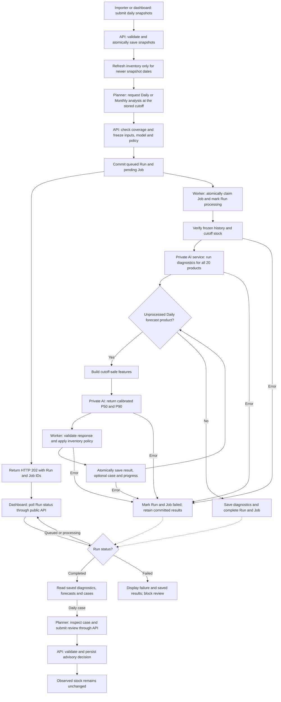
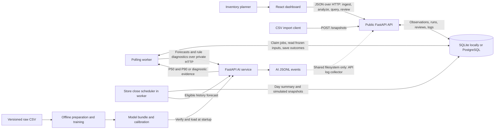
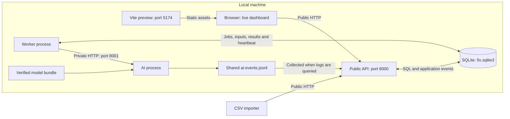
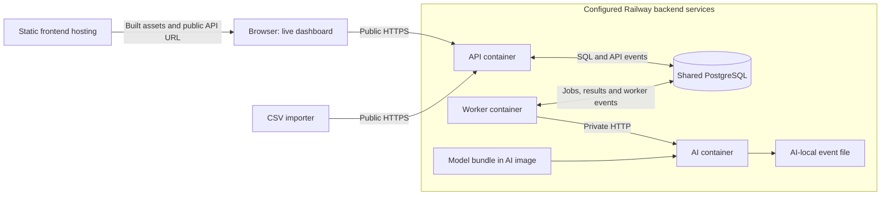
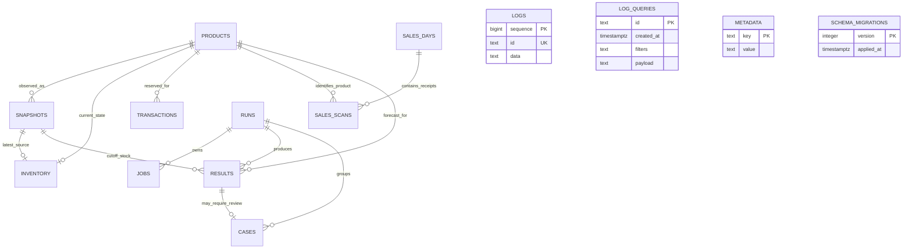
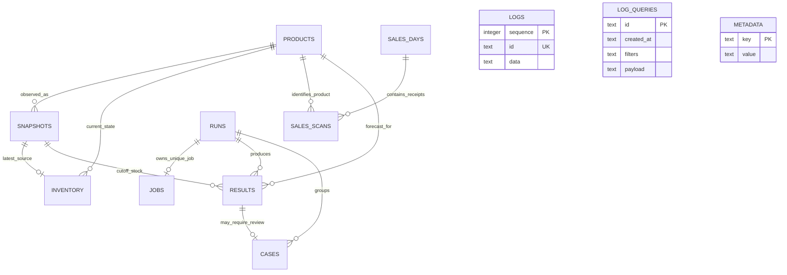
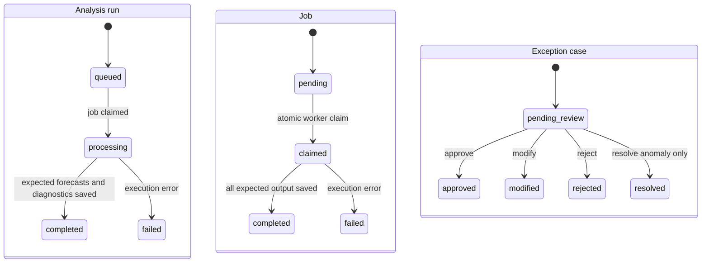

# Project F.I.X. Architecture

This document describes `main` at `48ffd90` (2026-11-27).

Project F.I.X. (Forecasting & Inventory Exceptions) converts daily retail snapshots into persisted sales forecasts, replenishment recommendations, and reviewable exceptions. The system combines a bilingual dashboard, a public API, durable database jobs, a background worker, and a private forecasting service.

## 1 Problem and Primary User

Inventory planners and analysts need to identify replenishment needs and unusual sales or stock conditions without manually checking every product each day. F.I.X. prioritizes exceptions and links recommendations to the observed inventory, historical sales, model version, policy and reviewer decision.

The application supports one selected store, **S001**, and products **P0001–P0020**. Store identity remains in snapshots, requests and results. The raw CSV contains 73,100 daily records across five stores and 20 products; the cleaned S001 panel contains 14,620 records. `Units Sold` is realized sales used as the forecasting target, `Inventory Level` is reported stock, and `Units Ordered` is an observed ordering signal rather than confirmed receipts. Lead times are simulated. The source `Demand Forecast` is retained only as a benchmark and excluded from inference features.

Analysis and human review produce recommendations and saved decisions. Current inventory is updated by newer imported snapshots or by the scheduled simulated store close. Forecast accuracy and inventory benefit require separate evaluation.

## 2 Primary Workflow

1. **Submit snapshots.** The verified CSV importer or dashboard sends daily S001 observations and provenance to the public API.
2. **Validate and persist.** The API atomically saves each bounded snapshot batch and updates current inventory only for newer business dates.
3. **Trigger analysis.** A planner requests Daily or Monthly analysis. The live dashboard takes its cutoff from the stored snapshot range reported by the API.
4. **Create durable work.** The API validates the cutoff and freezes input references, diagnostic rules, model and policy metadata. It commits a queued run and pending job and returns `202 Accepted` with both IDs.
5. **Run diagnostics.** The worker claims the job, commits processing state, verifies frozen snapshots and requests Daily or Monthly rule-based diagnostics for all 20 products.
6. **Forecast Daily demand.** For each eligible Daily product, the worker builds cutoff-safe features and calls the private AI service for calibrated cumulative P50/P90 forecasts.
7. **Persist outcomes.** The worker saves each Daily forecast and any review case atomically per product. On successful completion it stores the full diagnostics on the run. Monthly produces diagnostics only.
8. **Review exceptions.** The planner inspects supporting results and records an approve, modify, reject or resolve decision through the public API.



### Daily and Monthly selection

| Property | Daily | Monthly |
| --- | --- | --- |
| Output | Rule diagnostics plus P50/P90 forecasts and optional review cases | Rule diagnostics covering sustained sales changes and recurring stockouts |
| Scope | Diagnostics cover all 20 S001 products | Diagnostics cover all 20 S001 products |
| Forecast selection | Positive cutoff sales, changed stock versus the previous calendar day, or no previous-day snapshot | Rule scan only |
| Coverage | All 20 cutoff snapshots and 29 consecutive dates for each forecast product | At least one snapshot on the cutoff date. The scan compares the latest 28 dates with the prior 28 and reports insufficient or inventory-limited evidence where applicable. |
| Forecast horizon | Product's fixed simulated lead time | — |

Daily model runs require a cutoff on or after **2023-09-01**. `GET /snapshots/latest` reports the latest stored date and a separate `cutoff_date` for the latest complete 29-day window across all 20 products. The live dashboard uses that cutoff for both modes when available and otherwise displays the latest stored date. The API validates eligibility at submission. Historical runs use dated snapshots. Daily diagnostics still run when no product is eligible for forecasting.

### Scheduled simulated store close

The worker also runs an inventory scheduler in a separate thread. The default settlement time for S001 is **22:00 Asia/Shanghai**. The scheduler persists its next business day in `metadata`, starts from the day it is first enabled, catches up due dates after restart, and preserves complete imported days.

For a due day, the scheduler uses the latest opening stock and sales history through the previous day. With 29 consecutive eligible dates, it calls the trained model, rounds cumulative P50 divided by lead time to estimate one day's sales, and rounds P90 up as the stock target. With insufficient eligible history it uses the versioned historical CSV baseline. The settlement caps recorded sales at available whole units and simulates receipts up to the target. The transaction writes product snapshots, updates current inventory where the date is newer, and saves the day's summary in `sales_days`. The summary and snapshots carry the forecast source.

The worker rechecks stock and history under a store write lock before committing. Repeating a completed close returns its stored summary. On failure the scheduler records a blocked status and retries after 30 seconds. A legacy open scan day is closed from its existing ledger. Simulated receipts represent an inventory movement in the demo. Human review is a separate path that saves an advisory decision.

## 3 Architecture and Boundaries



SQLite is the default local persistence backend. Setting `FIX_DATABASE_URL` selects PostgreSQL for both API and worker, with a per-process `psycopg_pool` connection pool. Connection failures propagate to the caller. The worker uses database rows as its durable queue.

### Components and repository structure

```text
src/                         React application, routing, pages, shared UI, i18n
frontend/                    Shared ES-module adapters, contracts, diagnostics
  tests/                     Browser-side workflow and transport tests
public/runtime-config.js     Public configuration loaded before API construction
local_backend/
  service.py                 Public API, ingestion, run creation, query and review
  schemas.py                 Strict snapshot, run and review request schemas
  storage.py                 SQL access, transactions, migrations, event storage
  worker.py                  Job claiming, frozen-input execution and policy
  inventory_schedule.py     Persisted store-close schedule and retries
  automatic_inventory.py    Atomic simulated sales, receipts and stock updates
  inventory_forecast.py     Real model and historical baseline for simulated close
  checkout.py               Store locks and legacy sales-ledger handling
  ai_service.py              Model-service wrapper with correlated file logging
  import_csv.py              Verified CSV import through the public API
  log_api.py                 Frozen log queries, pagination and NDJSON export
  migrations/                PostgreSQL SQL migrations 001–004
  tests/                     Database/API/worker workflow tests
integration/worker_ai.py      Private HTTP model client and response validation
ai/                          Features, Predictor, FastAPI service and schemas
  artifacts/s001-global-q-v1/ Frozen models, catalog, schema, calibration, hashes
  notebooks/                 Original model notebook and Colab training notebook
  reports/                   Stored evaluation and feature-importance reports
  tests/                     Feature, data and service-contract tests
  integration_tests/         Actual model loading and prediction regression
data/                        Raw CSV, cleaned S001 data and provenance manifests
scripts/                     Local start/stop and full-flow verification helpers
deploy/                      API, worker and AI Dockerfiles
.github/workflows/deploy.yml  Static dashboard build and GitHub Pages deployment
```

| Component | Responsibility and boundary |
| --- | --- |
| React UI (`src/`) | Operations overview, inventory history and snapshot transfer, analysis creation/status/results, exception queue/detail/review, and logs in English and Chinese. |
| API gateway (`frontend/api-gateway.js`) | Gives pages a common API surface, assigns request IDs, and records browser observations. |
| Request/response contracts (`frontend/requests.js`, `contracts.js`) | Allowlist submitted fields; validate identities, envelopes, states, finite numbers, quantile ordering and traceability. |
| Live adapter and HTTP client | Map operations to public routes; apply timeouts/cancellation, validate HTTP status and JSON, and expose uncertain write outcomes. No automatic write retry or live-to-mock fallback. |
| Public API (`local_backend/service.py`) | Validates and persists snapshots, serves the runnable cutoff and settlement summaries, creates durable jobs with frozen inputs, returns stored outcomes, and enforces review transitions. |
| Storage layer (`local_backend/storage.py`) | Direct SQL via `sqlite3` or pooled PostgreSQL connections, transaction scopes, migrations, serialization and persisted events. |
| Worker (`local_backend/worker.py`) | Claims analysis jobs, calls AI, applies policy, persists diagnostics and forecasts, and runs the store-close scheduler in a separate thread. |
| AI client (`integration/worker_ai.py`) | Builds cutoff-safe features and validates forecast identity and provenance, along with diagnostic identity, policy version, product coverage and evidence. Uses a 30-second HTTP timeout by default. |
| AI service (`ai/`, wrapped by `local_backend/ai_service.py`) | Verifies and loads trained LightGBM models once, returns calibrated forecasts, and runs Daily and Monthly statistical rules. |

### Frontend composition and modes

`src/main.jsx` first loads `runtime-config.js`, validates `FIX_CONFIG`, applies the hosted `VITE_FIX_API_URL` override when configured, and then imports `bootstrap.jsx`. Bootstrap mounts React with the language provider and hash router. A configuration-load failure renders a startup error.

The home route opens `/#/overview`, which shows inventory, recent sales, pending reviews and recent runs opened in this browser. Other routes are `/#/inventory`, `/#/analysis`, `/#/analysis/:runId`, `/#/exceptions`, `/#/exceptions/:caseId`, and `/#/logs`. The Logs page shows backend events and browser diagnostics. Pages use the common API in `src/workflow.js`. Analysis polls every 1,500 ms by default until `completed` or `failed`, then retrieves results. Resource hooks and page effects ignore stale responses after navigation and cancel supported reads.

Two explicitly configured adapters implement the workflow:

- **Live:** the public backend is authoritative for inventory, runs, results and reviews. The HTTP timeout defaults to 10 seconds; it is separate from the longer asynchronous job execution.
- **Mock:** six synthetic product fixtures, fixed illustrative Daily forecasts, elapsed-time state simulation, and browser-local runs/reviews under `fix-demo-v1`. This mode is independent of the CSV, real worker and trained models. Its fixture date remains 2022-06-30. Monthly is available in live mode.

The shipped runtime configuration selects live mode on `localhost`/`127.0.0.1`; hosted pages select mock unless a public API URL is configured. Browser diagnostics retain up to 300 entries under `fix-dashboard-log-v1` and can fall back to memory. These entries are observations, not server audit evidence.

### Deployment and configuration

The following views separate the local shared-filesystem arrangement from the configured hosted service topology. They describe process and storage boundaries; hosted service readiness is checked separately.



The local launcher uses SQLite when `FIX_DATABASE_URL` is unset. API, worker and AI share the configured local state directory; the model bundle is read from the repository's artifact directory.



The hosted view has no event-file connection from AI to API: each container has its own filesystem. API and worker events reach PostgreSQL, while collecting AI events requires an additional shared logging mechanism. The model HTTP path is independent of that logging limitation.

| Environment | Implemented arrangement |
| --- | --- |
| Local integration | `scripts/start-local-demo.ps1` starts AI on 8001, public API on 8000, a worker with the settlement scheduler, and optionally Vite preview on 5174. Default database and AI event file share `.local-integration/`. Import snapshots separately to seed opening inventory. |
| GitHub Pages | Workflow builds only static `dist/` with `VITE_BASE_PATH=/FIX_dashboard/`. It does not run Python, the worker or a database. |
| Railway configuration | Three Dockerfiles run API, worker and AI as separate Python services. API and worker share PostgreSQL; worker calls AI over private HTTP. A separately hosted static frontend uses the public API. This repository supplies deployment instructions/configuration, not proof of a healthy hosted installation. |

Key settings are `FIX_DATABASE_URL` (API/worker database), `FIX_AI_URL` (worker's private model URL), `FIX_ALLOWED_ORIGINS` (API CORS allowlist), `FIX_LOCAL_STATE` (local SQLite/events), `PORT` (HTTP container port), and public browser `FIX_CONFIG`. `FIX_STORE_TIMEZONE` and `FIX_STORE_CLOSE_TIME` configure the API and worker's store clock and daily settlement time. `VITE_FIX_API_URL` is a public build-time API URL, and `VITE_BASE_PATH` controls static asset paths. Database secrets belong only in backend service environments.

Railway containers have independent filesystems. The API cannot collect the AI container's local event file, so AI log coverage remains incomplete until shared logging is implemented, even if predictions succeed. API and worker can still persist their own events in PostgreSQL. No Docker Compose stack is supplied.

The API currently has configurable CORS but no authentication or authorization. Reviewer labels are unverified input. PostgreSQL migrations enable row-level security on the application tables. The private model service should remain private, and model bundles must be trusted because loading joblib deserializes executable Python objects. Hosted acceptance, API access control, backups and retention remain deployment work. See [local integration](local-integration-zh.md) and [Railway deployment](railway-deploy-zh.md).

## 4 Persistent Entities and ERD

The database preserves raw observations separately from current inventory and computed outcomes. PostgreSQL stores normalized constraint/query columns alongside serialized API payloads in `data TEXT`; `runs.frozen_input` retains the execution manifest. SQLite uses a smaller local schema with more fields in serialized payloads. They expose the same workflow API but do not have identical physical schemas.

### Persistent entities

| Table | Role and important constraints |
| --- | --- |
| `products` | Product identity and name; `id` PK. Names initially use product IDs; category is retained on snapshot payloads. |
| `snapshots` | Immutable imported or simulated daily records and provenance; `id` PK, product FK, unique `(store_id, product_id, snapshot_date)`. Raw category/region remain in the serialized payload. |
| `inventory` | Latest stored stock; `product_id` PK in PostgreSQL, product/snapshot FKs, snapshot date, on-hand and initial quantity, fixed lead time. `store_id` remains S001. |
| `runs` | Analysis identity/state/cutoff, counts, versions, retained frozen input and the diagnostic payload saved at completion. |
| `jobs` | Durable execution state, run FK, attempts/error/timestamps. The schema permits multiple jobs per run; the API creates exactly one. Run reads select the latest job. |
| `results` | Forecast, cutoff stock, policy outputs and traceability; run/product/snapshot FKs, unique `(run_id, store_id, product_id)`, nonnegative quantities and P90 ≥ P50. |
| `cases` | Optional exception for a result; unique result FK, run FK, exception type/state and review fields. API `reviewer_label` maps to normalized `reviewer_identity`. |
| `transactions` | Product-linked transaction schema reserved for future sources. CSV import and simulated settlement persist daily snapshots. |
| `sales_days` | Store-close state and summary, keyed by `(store_id, business_date)`. A partial unique index allows at most one open day per store. |
| `sales_scans` | Legacy scanned-sales receipts. `scan_id` is the PK and foreign keys reference the business day and product. The scheduler preserves and closes existing scan ledgers. |
| `logs` | Persisted application events with unique event ID and increasing collection sequence. |
| `log_queries` | Frozen filters and full matching event payload for stable pagination/export. |
| `metadata` | Worker heartbeat, AI log collection offset and store-close schedule state. |
| `schema_migrations` | Applied PostgreSQL migration versions. |

`inventory.initial_quantity` is refreshed from the earliest stored snapshot, including historical backfills. `default_shipping_method` is initially NULL. Its nullable `safety_stock` column is not updated by forecast processing: the authoritative computed value is stored on each result.



This ERD includes the PostgreSQL tables after migrations 001–004. Lines represent declared foreign keys. Log correlation, frozen log-query membership and links from a day summary to its snapshots are application-level associations. The database allows multiple jobs per run, while the current API creates one job for each new run.

SQLite has a separate physical schema:



SQLite inventory has composite PK `(store_id, product_id)`, jobs have a unique `run_id`, and results have unique `(run_id, product_id)`. The product-to-inventory relationship reflects that composite key, although the application operates only on S001. Each API-created run has exactly one job; the optional child notation expresses what the foreign key and uniqueness constraints alone permit. SQLite has neither `transactions` nor `schema_migrations`; schema revision is recorded in `PRAGMA user_version`.

There is no Store table. Both request validation and PostgreSQL constraints scope snapshots to S001. Application validation and frozen-reference checks enforce cross-entity store/product consistency alongside database foreign keys and uniqueness constraints. Neither ERD introduces a direct inventory-to-result foreign key: each result references its observed cutoff snapshot.

### Integrity and Migration Decisions

PostgreSQL initialization uses versioned SQL files, `schema_migrations`, and an advisory transaction lock to serialize migrations. Migration `003` enables row-level security on the existing tables. Migration `004` creates the two sales-ledger tables and enables row-level security on them. SQLite initializes its schema with `PRAGMA user_version=2`, foreign keys and WAL. SQLite and PostgreSQL maintain separate records.

The PostgreSQL migrations define numeric checks, canonical state constraints, product/run/snapshot/result foreign keys and workflow uniqueness. Normalized fields support relational validation while serialized payloads preserve API response fields. Store isolation is limited to S001; the current inventory product key does not support multiple stores sharing a product.

### Atomic Ingestion and the Current View

`local_backend.import_csv` verifies the source file against the model manifest's SHA-256, selects S001, preserves row references, and submits batches of at most 100 records through the public API. It compares previously imported rows and refuses conflicting source data. The dashboard also provides snapshot JSON transfer through the same API.

The API accepts strict observation fields, including raw category/region/discount, stock, sales, orders and a signed finite `demand_forecast_benchmark`. Each batch commits all snapshots and inventory updates together. Duplicate business keys return 409 and roll back the batch. Atomicity is per batch, not per entire imported file. The public API validates the supplied hash format; the bundled importer performs the full source-file hash verification.

Inventory updates only when the incoming business date is newer. Older backfills remain available as history without rolling current stock backward. CSV import uses the reported `Inventory Level` as the stock value. The shared store lock coordinates imports with scheduled settlement, and a legacy open sales day blocks imports that would advance current inventory. Snapshots are immutable through the public API.

### Historical Runs and Frozen Inputs

`POST /analysis-runs` accepts `store_id`, `run_type` and `as_of_date`. Daily requires cutoff snapshots for all 20 products and all 29 dates from `t−28` through `t` for each forecast product. Monthly accepts a cutoff with at least one stored observation. Its diagnostic rules report missing dates per product.

One transaction persists the queued run, pending job, and frozen manifest. The manifest retains forecast products, the available diagnostic history for all 20 products, snapshot IDs and source hashes, diagnostic rule and policy versions, model/schema versions, model manifest hash and originating request ID. A run-specific `input_reference` identifies this retained manifest. Each run continues to use the same history after later imports.

When the forecast set is empty, the worker runs diagnostics and can complete with zero forecast rows. Invalid coverage or an unsupported store returns 422 before work is queued.

## 5 State transitions and review semantics



Jobs follow `pending → claimed → completed|failed`. The API owns initial run/job creation and review writes; the worker owns processing and terminal computation states. Computation completion and human review completion are separate.

`job_completed` and `job_failed` are diagram aliases; their stored values are `completed` and `failed`. The claim transaction advances Job to `claimed` and Run to `processing` together. The finish transaction advances both to the corresponding terminal state. A process crash does not create a failure transition automatically: durable records may remain `claimed`/`processing`, and no lease-expiry or retry transition is implemented. Review transitions require the completed parent run and case-specific validation described below.

Only `pending_review` cases from a completed, non-partial run can be finalized. PostgreSQL locks the case row; SQLite serializes the write. The update is conditional on the pending state; repeat decisions return 409.

| Decision | Saved state | Quantity and reason semantics |
| --- | --- | --- |
| `approve` | `approved` | Server accepts the saved recommendation; no submitted quantity. Combined cases require a reason. |
| `modify` | `modified` | Requires a nonnegative integer quantity and reason. |
| `reject` | `rejected` | Saves zero accepted quantity and requires a reason. |
| `resolve` | `resolved` | Anomaly-only closure; no order quantity and a required reason. |

Reviewer label and timestamp are retained. Anomaly-only cases accept `resolve`; reorder and combined cases accept approve/modify/reject. The API does not implement login or verified reviewer identity. No reopen or multi-event review history is implemented.

## 6 API and service contracts

| Service | Method and route | Purpose |
| --- | --- | --- |
| Public API | `POST /snapshots` | Atomic 1–100-row ingestion; 201 with inserted count/IDs. |
| Public API | `GET /snapshots` | S001 observations, optional product and `from`/`to` filters. |
| Public API | `GET /snapshots/latest` | First and latest stored dates and the latest runnable Daily cutoff. |
| Public API | `GET /inventory`, `GET /inventory/{store_id}/{product_id}` | Current stored inventory. |
| Public API | `GET /inventory/automation` | Business date, scheduler state, last settled date, next settlement time and blocking detail. |
| Public API | `GET /sales/day?business_date=YYYY-MM-DD` | Saved settlement summary with product-level movement details. |
| Public API | `POST /analysis-runs` | Queue a Daily or Monthly run and return 202 with run/job IDs. |
| Public API | `GET /analysis-runs/{run_id}` | Stored state, job, counts, timestamps and failure/completeness context. |
| Public API | `GET /analysis-runs/{run_id}/results` | `{results, status, partial, diagnostics}`. The forecast array includes normal Daily forecasts. A completed Monthly run has diagnostics and an empty forecast array. |
| Public API | `GET /exceptions`, `GET /exceptions/{case_id}` | Cases, supporting results and parent-run state. |
| Public API | `POST /exceptions/{case_id}/review` | Persist the validated advisory decision. |
| Public API | `GET /logs`, `GET /logs/export` | Filtered event snapshot, pagination and complete NDJSON export. |
| Public API | `GET /health/live`, `GET /health/ready` | Liveness; database access plus worker heartbeat freshness. |
| Private AI | `POST /analyze` | One product's features → calibrated forecast and traceability. |
| Private AI | `POST /forecast/closed-day` | Dated 29-day history and caller-supplied expected close date → forecast with horizon dates. The scheduler uses `/analyze` via the shared worker client. |
| Private AI | `POST /diagnostics/{mode}` | Frozen per-product history, store, cutoff and input reference → versioned rule findings for `daily` or `monthly`. |
| Private AI | `GET /health/live`, `GET /health/ready` | Liveness and loaded-predictor readiness. |

The public API generally returns 422 for invalid inputs/coverage, 404 for missing records, and 409 for duplicate snapshots or invalid review states. The model service maps validation and `ValueError` to 422, unavailable predictor to 503, and other inference failures to 500. Invalid predictions are never substituted with zero or mock values.

List endpoints use arrays; results use their documented envelope. The browser validates these contracts before displaying success. A timed-out write or malformed successful response can leave the write outcome uncertain, so the transport marks that uncertainty and never retries automatically. Detailed contracts are in [frontend API](frontend-api-contract.md), [model API](model-contract.md), and [backend logs](backend-logs-contract.md).

A Daily request identifies the store, mode and cutoff. This example uses the cutoff observed in the local verification:

```http
POST /analysis-runs
Content-Type: application/json

{"store_id":"S001","run_type":"daily","as_of_date":"2024-01-01"}
```

```json
{
  "analysis_run": {"id": "<run-id>", "status": "queued"},
  "job": {"id": "<job-id>", "status": "pending"}
}
```

The private `/analyze` request contains store/product identity, cutoff date, fixed lead time, `feature_schema_version`, `input_reference` and the feature vector. Its response echoes identity and reference fields and adds `horizon_days`, quantile forecasts and the actual model version. Inventory policy fields and exception IDs are added by the worker, not the forecasting service.

## 7 Worker and AI processing

### Durable Execution

The worker polls every 0.5 seconds and processes products sequentially. SQLite serializes claims with `BEGIN IMMEDIATE`; PostgreSQL selects eligible jobs with `FOR UPDATE OF jobs SKIP LOCKED`. Claim and processing states are committed before network inference, avoiding a long database transaction around the model call.

Before Daily forecasting, the worker verifies the current model manifest hash against the frozen manifest. For both modes it checks retained snapshot identity and source hashes, then calls the diagnostics endpoint. For each Daily forecast product, the HTTP model client constructs features, validates the response, and passes it to the worker for policy calculation using the stored cutoff stock.

Each forecast result, optional case, progress count, heartbeat and persistence event commit together. Successful completion requires processed and expected forecast counts to agree and stores the diagnostic payload in the run. On failure, the worker keeps previously committed forecasts and records failed job/run states. The diagnostics payload is written only on successful completion.

### Inventory and Lead-time Assumptions

The analysis cutoff follows an end-of-day convention: today's observed sales are available, and the forecast starts on the following day. The source does not establish whether its inventory measurement is a start- or end-of-day balance, so the calculation treats reported cutoff stock as the available quantity for this simulation. Open orders and reserved stock are not modeled.

| Frozen scenario category | Lead time in days |
| --- | ---: |
| Groceries | 3 |
| Toys | 7 |
| Clothing | 10 |
| Electronics | 14 |
| Furniture | 21 |

Assignments are synthetic, fixed per product in the model catalog, and repeat across the 20 product IDs. Raw snapshot category/region remain separate observations. The policy and catalog hash are frozen with each run.

### Features and Leakage Controls

`ai.features.build_request` requires a single store/product series and exactly 29 consecutive dates in the feature window. It rejects missing/duplicate dates, mixed identities and invalid sales; future rows do not enter features. Features are today's sales, lags 1/7/14/28, preceding-day rolling means over 7/28 days, and preceding-day 28-day sample standard deviation (`ddof=1`). The service adds product ID, fixed lead time, cutoff weekday and month, then applies manifest column order and categorical encoding.

Stock, source `Demand Forecast`, future observations and model targets are excluded from the feature payload. Price/weather/promotion fields retained in the data are not used by the current model. Precomputed feature requests cannot themselves prove temporal correctness; the worker and feature builder establish the cutoff boundary.

### Target and Replenishment rule

The frozen bundle `s001-global-q-v1` contains two pooled LightGBM quantile models, lead-time-specific P90 calibration, feature schema, product catalog, manifest and checksums. It forecasts **cumulative realized sales over t+1 through t+L**, rather than daily sales or unconstrained latent demand. Do not multiply the output by the horizon again.

At startup `Predictor` checks the six bundle-file hashes, schema/manifest agreement and model feature order before serving predictions. The integration wrapper sets model execution to one thread. Calibration is:

```text
p50 = max(0, raw_p50)
p90 = max(p50, max(0, raw_p90) + correction_by_lead_time_days[L])
```

Responses enforce finite nonnegative quantiles and P90 ≥ P50. `AnalyzeRequest` rejects extra fields. Correlation IDs travel in HTTP headers. The forecast route returns quantiles, the diagnostics route applies statistical rules, and the worker computes replenishment quantities.

```text
safety_stock = P90 - P50
recommended_order_quantity = ceil(max(0, P90 - cutoff_inventory))

baseline = mean(sales from t-28 through t-1)
unusual_sales_threshold = max(5, 2 * baseline)
unusual_demand = sales_at_t > unusual_sales_threshold
anomaly_score = sales_at_t / max(baseline, 1)
anomaly_severity = 1 if unusual_demand or persistent_zero_stock else 0
```

The replenishment policy version is `local-integration-policy-v1`. Its settings and catalog hash are frozen with the run. `anomaly_threshold` records the threshold in sales units. For a forecast product, replenishment alone creates a `reorder` case, a diagnostic anomaly alone creates `anomaly`, and both together create `reorder_and_anomaly`. Normal forecasts are stored without a case. Explanations are deterministic templates.

### Rule-based diagnostics

`ai/diagnostics.py` implements `s001-diagnostics-v1`. Each finding includes a status, reason and supporting evidence. Daily high sales uses the threshold above and Daily persistent zero stock requires at least three consecutive days ending at the cutoff. The diagnostic scan covers all 20 products, while case creation is limited to forecast products.

Monthly requires 56 consecutive observations per product to compare the latest 28 days against the preceding 28. It compares matched weekdays with positive inventory in both periods and requires at least four comparable days per weekly pair. A sustained sales change must reach 25% and at least one unit per day in the same direction across at least three weekly pairs and their combined sample. Fewer than three comparable weekly pairs produces an inventory-limited sales finding. Seven zero-stock days or three stockout periods in the recent window trigger the stockout finding. Monthly outcomes are stored on the run for viewing.

### Evaluation and traceability

The original training and evaluation notebook is `ai/notebooks/model_v1.ipynb`. The maintained Colab notebook is `ai/notebooks/train_s001_colab.ipynb`. Reports and provenance manifests are versioned alongside the runtime bundle. `ai/scripts/prepare_data.py` rebuilds the clean S001 panel from the verified raw CSV and frozen catalog without training or database writes.

Chronological split boundaries keep training labels through 2023-04-30 and validation/calibration labels through 2023-08-31. The earliest supported analysis origin is 2023-09-01. Stored reports record forecast error and quantile evaluation; final test outcomes are evaluation evidence rather than a source for threshold tuning. Forecasts describe realized sales and do not establish unconstrained demand or inventory savings.

Each result retains model/schema/policy versions, cutoff snapshot identity, input reference, triggered reasons, processing timestamp and duration. The manifest records the training runtime; deployment images use Python 3.13 and Railway requirements. Target-environment compatibility requires model-loading and regression checks.

## 8 Failure handling and observability

Analysis jobs move through `pending → claimed → completed|failed`. Job claiming also advances the parent run. A caught model or processing error marks both failed and retains previously committed forecasts. The run is marked `partial` when forecasts were already saved, and review is blocked. A crash after claim can leave `claimed`/`processing` until operator investigation. Analysis jobs lack automatic replay, and the worker heartbeat tracks availability. The separate store-close scheduler retries a due day after a settlement failure.

API and worker write structured events to `logs`. The AI wrapper writes `.local-integration/ai-events.jsonl` (or the directory selected by `FIX_LOCAL_STATE`); the API log collector imports complete lines with deduplication and a retained byte offset. Request, run, job, product, case and trace IDs correlate stages; run ID is the trace ID for analysis work. Global sequence reflects collection order, while timestamps retain original event time.

`GET /logs` freezes matching events and filters into `log_queries`. Subsequent pages and export use that snapshot ID, so new events cannot shift pagination. Export returns the full frozen match set, not just the displayed page. Coverage distinguishes available/partial/unavailable sources; file collection availability does not establish current AI liveness.

Public readiness checks database connectivity and a worker heartbeat less than 30 seconds old. It does not probe AI or guarantee progress of an individual run. AI readiness checks predictor loading. There is no `/metrics` endpoint, automatic retention policy, distributed tracing backend, or production audit system in the current code.

| Failure condition | Behavior |
| --- | --- |
| Invalid or duplicate snapshot batch | Reject without partial application of that batch. |
| Unsupported scope/date or insufficient history | Return 422 before creating a run/job. |
| Model HTTP error, invalid identity or invalid forecast | Record failure; retain committed results; never invent a successful output. |
| Process crash after job claim | Claimed/processing records remain durable; operator investigation is required. |
| Scheduled close blocked by missing opening stock, conflicting snapshots or a forecast error | Leave the day unposted, record the blocking detail, and retry. Check `GET /inventory/automation` and the worker log. |
| Uncertain browser write outcome | Mark uncertainty, preserve correlation and avoid automatic resubmission. |
| Missing AI event file in another container | Report incomplete log coverage while API/worker events remain queryable. |

## 9 Persistence evidence and acceptance plan

Acceptance checks cover both successful persistence and the behavior of incomplete or failed work:

| Check | Acceptance criterion |
| --- | --- |
| Snapshot persistence | Batch observations and inventory refresh commit together; duplicate/invalid batch leaves both unchanged. |
| Historical correctness | Backfill cannot roll current stock backward; historical analysis uses its retained cutoff/history. |
| Durable work | Returned IDs identify committed run/job records; concurrent claims cannot own the same pending job. |
| Forecast traceability | Results reference retained observations and model/schema/policy versions; benchmark fields do not reach AI features. |
| Diagnostics | Daily and Monthly runs save findings for all 20 products. Monthly results contain zero forecast rows. |
| Normal and exceptional results | Normal forecasts remain queryable; reorder, anomaly-only and combined cases follow their defined review rules. |
| Human review | A saved decision survives reload/restart, rejects repeat review, and does not change stock. |
| Scheduled settlement | Record each business day once, preserve complete imported days, and commit sales, simulated replenishment and closing balances together. |
| Failure and completeness | Partial results remain inspectable with review blocked. A run with zero forecast products can complete after diagnostics. |
| Logs | Correlated events, stable pagination and complete snapshot export agree. |
| PostgreSQL deployment | Apply migrations 001–004 on a dedicated database, verify constraints and repeat the workflow against actual services. |

The repository provides these verification layers:

- `npm test`: mock workflow, live HTTP adapter, request/response contracts, browser diagnostics, data flow and backend-log client behavior using controlled responses.
- `ai/tests`: feature/data integrity, calibration and HTTP contract checks using a service stub.
- `ai/integration_tests/test_real_model.py`: loads the actual artifacts and checks a frozen prediction against the notebook reference.
- `integration/tests`: worker-to-AI transport/identity/cutoff validation with controlled transport.
- `local_backend/tests`: database transaction atomicity, frozen runs/claims, policy, review, partial failures, log snapshots, settlement schedules and inventory forecast behavior. Uses SQLite by default, with controlled model output for workflow tests.
- PostgreSQL tests require a dedicated disposable database selected with `FIX_TEST_POSTGRES_URL`; they clear workflow tables and are skipped without that setting.
- `scripts/verify-local-demo.mjs`: explicit live-system verification that creates a real run and review against running services.

An isolated Windows/SQLite acceptance run against `48ffd90` imported 14,620 observations through the public API. The real-model smoke check saved 20 forecasts and an advisory approval, and verified 177 correlated API, worker and AI events through pagination and export. After restart, the API returned the forecasts and approval. The Daily and Monthly requests using the advertised cutoff both completed with findings for 20 products. Daily stored 20 forecast rows and Monthly stored zero. Frontend entry and health endpoints were checked over HTTP. PostgreSQL and the hosted Railway stack require separate acceptance. See the [local integration guide](local-integration-zh.md) and [daily inventory guide](daily-data-entry-zh.md).

## 10 Keep Adapt Add and Risk Conclusions

| Area | Architectural conclusion |
| --- | --- |
| Keep | Maintain the public API/database/worker/private-AI boundaries, durable asynchronous execution and human review. |
| Adapt | Use PostgreSQL for shared service persistence and SQLite for local integration, preserving the same public workflow contract. |
| Add | Extend deployment with verified service connectivity, shared AI event collection, access control and operational retention as required. |
| Risk | Treat simulated lead times, source stock timing, incomplete histories, stale claims and environment-specific validation as explicit limits. |

The one-store workflow combines snapshot persistence, cutoff-safe forecasting, rule diagnostics, advisory review and scheduled simulated inventory settlement. Components exchange versioned contracts so that browser presentation, inventory policy and model inference can evolve independently.

## 11 Risks and scope cuts

| Risk | Mitigation or current boundary |
| --- | --- |
| Weak forecasting signal or sales censoring | Evaluate temporal forecasts and disclose that realized sales are the target; avoid unsupported savings claims. |
| Unstable source metadata and uncertain stock timing | Preserve raw fields; use a frozen synthetic lead-time catalog and explicit cutoff convention. |
| Future information leakage | Enforce dated frozen inputs, 29-day feature windows, feature allowlists and supported historical cutoffs. |
| Missing history and inactive-product gaps | Reject incomplete Daily forecast inputs. Monthly reports gaps and inventory-limited comparisons. Scheduled simulation uses the historical baseline when eligible model inputs are unavailable. |
| Noisy alerts | Preserve exact policy thresholds, scores and reasons; evaluate alert quality before expanding rules. |
| Worker crash after claim | Retain visible durable state and logs; job leases and safe stale-claim recovery remain future work. |
| Independent container filesystems | Use coverage reporting; shared AI log collection is required for complete hosted traces. |
| Public deployment without verified identity | Add authentication/authorization and a verified audit actor before relying on reviewer identity. |
| Capacity and persistence operations | Validate the PostgreSQL connection pool, backups and data/log retention in the deployment environment. |

The implemented scope is S001 Daily forecasting, Daily and Monthly diagnostics, advisory exception review and scheduled simulated settlement. Live purchasing, new transaction or scan ingestion, cross-store/warehouse optimization, supplier optimization, ERP integration, dynamic pricing and trained anomaly models are outside the current scope.
