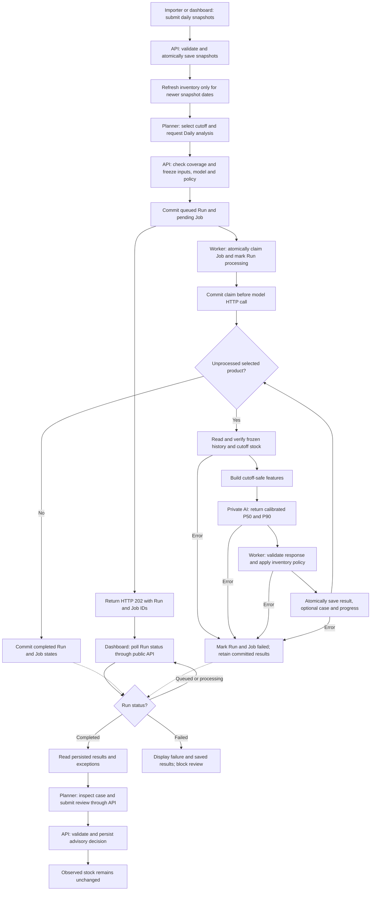
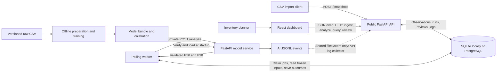
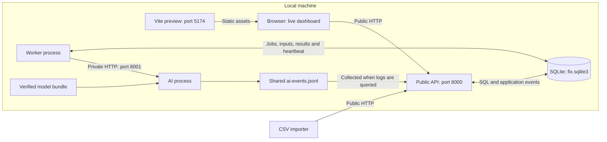
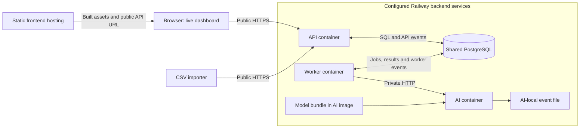
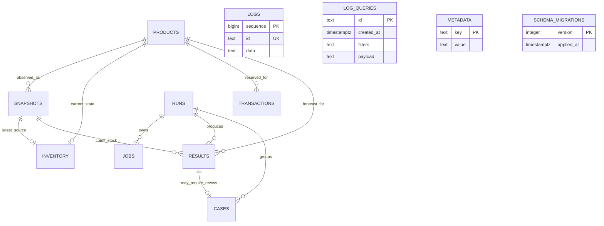
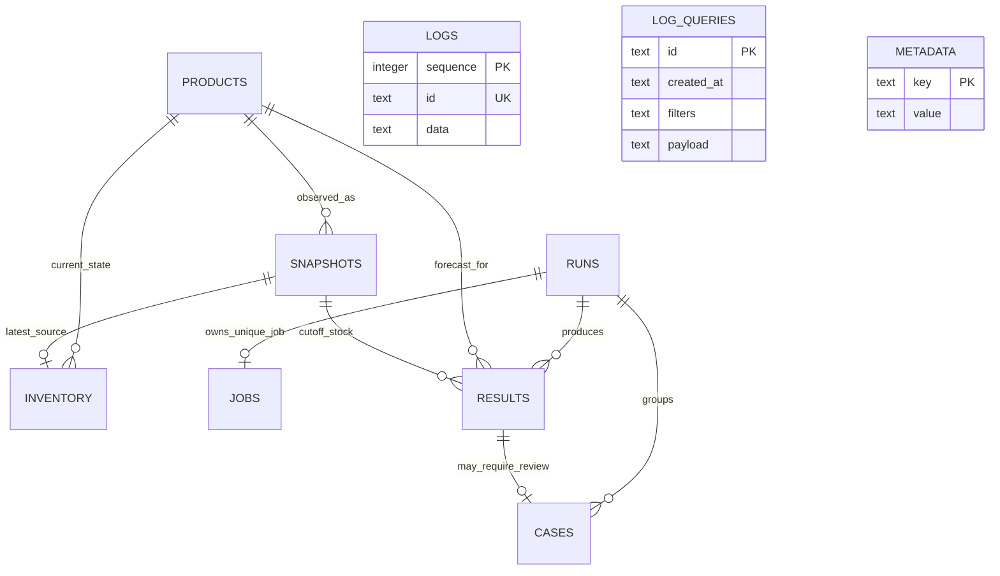
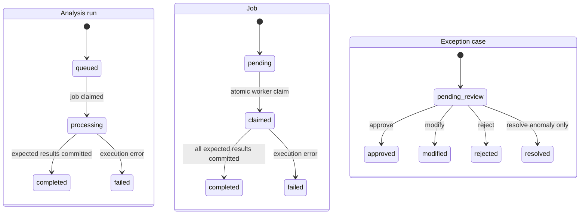

# Project F.I.X. Architecture

Project F.I.X. (Forecasting & Inventory Exceptions) converts daily retail snapshots into persisted sales forecasts, replenishment recommendations, and reviewable exceptions. The system combines a bilingual dashboard, a public API, durable database jobs, a background worker, and a private forecasting service.

## 1 Problem and Primary User

Inventory planners and analysts need to identify replenishment needs and unusual sales or stock conditions without manually checking every product each day. F.I.X. prioritizes exceptions and links recommendations to the observed inventory, historical sales, model version, policy and reviewer decision.

The application supports one selected store, **S001**, and products **P0001–P0020**. Store identity remains in snapshots, requests and results. The raw CSV contains 73,100 daily records across five stores and 20 products; the cleaned S001 panel contains 14,620 records. `Units Sold` is realized sales used as the forecasting target, `Inventory Level` is reported stock, and `Units Ordered` is an observed ordering signal rather than confirmed receipts. Lead times are simulated. The source `Demand Forecast` is retained only as a benchmark and excluded from inference features.

Analysis and human review are advisory: they do not change observed stock, write transactions or submit purchase orders. Accepted newer snapshots update current inventory. Forecast accuracy and inventory benefit require separate evaluation.

## 2 Primary Workflow

1. **Submit snapshots.** The verified CSV importer or dashboard sends daily S001 observations and provenance to the public API.
2. **Validate and persist.** The API atomically saves each bounded snapshot batch and updates current inventory only for newer business dates.
3. **Trigger analysis.** A planner selects a cutoff and requests Daily analysis. The API checks complete cutoff coverage and the history required for eligible products.
4. **Create durable work.** The API freezes input references, model and policy metadata, commits a queued run and pending job, and returns `202 Accepted` with both IDs.
5. **Prepare features.** The worker claims the job, commits processing state, retrieves frozen history and builds cutoff-safe features.
6. **Call AI.** The private model service returns calibrated cumulative P50/P90 forecasts. The worker validates identity, horizon, versions and numeric values.
7. **Persist outcomes.** The worker applies replenishment and unusual-sales rules, saving every forecast and an optional exception case atomically per product.
8. **Review exceptions.** The planner inspects supporting results and records an approve, modify, reject or resolve decision through the public API.



### Daily and Monthly selection

| Property | Daily | Monthly |
| --- | --- | --- |
| Availability | Implemented; manually triggered | Unsupported; requests return 422 |
| Scope | S001, frozen 20-product roster | No execution path |
| Selection | Positive cutoff sales, changed stock versus the previous calendar day, or no previous-day snapshot | No selection policy executed |
| Coverage | All 20 cutoff snapshots; 29 consecutive dates for each selected product | Not applicable |
| Forecast horizon | Product's fixed simulated lead time | Not applicable |

Real-model analysis requires a cutoff on or after **2023-09-01**; the local dashboard defaults to **2023-11-15**. Missing history is rejected rather than filled with zero. Complete coverage with no eligible Daily products produces a successful run with zero results. Historical runs use dated snapshots rather than today's stock.

## 3 Architecture and Boundaries



SQLite is the default local persistence backend. Setting `FIX_DATABASE_URL` selects PostgreSQL for both API and worker; a PostgreSQL connection failure does not trigger a SQLite fallback. The worker uses database rows as its durable queue. There is no Redis, Celery, or external message broker.

### Components and repository structure

```text
src/                         React application, routing, pages, shared UI, i18n
frontend/                    Shared ES-module adapters, contracts, diagnostics
  tests/                     Browser-side workflow and transport tests
public/runtime-config.js     Public configuration loaded before API construction
local_backend/
  service.py                 Public API, ingestion, run creation, query and review
  schemas.py                 Strict snapshot, run and review request schemas
  storage.py                 SQL access, transactions, migrations, event storage
  worker.py                  Job claiming, frozen-input execution and policy
  ai_service.py              Model-service wrapper with correlated file logging
  import_csv.py              Verified CSV import through the public API
  log_api.py                 Frozen log queries, pagination and NDJSON export
  migrations/                PostgreSQL SQL migrations 001 and 002
  tests/                     Database/API/worker workflow tests
integration/worker_ai.py      Private HTTP model client and response validation
ai/                          Features, Predictor, FastAPI service and schemas
  artifacts/s001-global-q-v1/ Frozen models, catalog, schema, calibration, hashes
  notebooks/                 Offline training notebook
  reports/                   Stored evaluation and feature-importance reports
  tests/                     Feature, data and service-contract tests
  integration_tests/         Actual model loading and prediction regression
data/                        Raw CSV, cleaned S001 data and provenance manifests
scripts/                     Local start/stop and full-flow verification helpers
deploy/                      API, worker and AI Dockerfiles
.github/workflows/deploy.yml  Static dashboard build and GitHub Pages deployment
```

| Component | Responsibility and boundary |
| --- | --- |
| React UI (`src/`) | Inventory and snapshot transfer, analysis creation/status/results, exception queue/detail/review, browser and backend logs; English/Chinese presentation. |
| API gateway (`frontend/api-gateway.js`) | Gives pages a common API surface, assigns request IDs, and records browser observations. |
| Request/response contracts (`frontend/requests.js`, `contracts.js`) | Allowlist submitted fields; validate identities, envelopes, states, finite numbers, quantile ordering and traceability. |
| Live adapter and HTTP client | Map operations to public routes; apply timeouts/cancellation, validate HTTP status and JSON, and expose uncertain write outcomes. No automatic write retry or live-to-mock fallback. |
| Public API (`local_backend/service.py`) | Validates and persists snapshots, freezes run inputs, creates durable jobs, returns stored results, and enforces review transitions. Run creation does not wait for inference. |
| Storage layer (`local_backend/storage.py`) | Direct SQL via `sqlite3` or a `psycopg` wrapper, transaction scopes, PostgreSQL migrations, serialization and persisted events. |
| Worker (`local_backend/worker.py`) | Claims one job, retrieves frozen history, calls AI, applies replenishment/anomaly rules, commits results and optional cases, and records success/failure. |
| Model client (`integration/worker_ai.py`) | Builds cutoff-safe features and checks response store/product/date/horizon/model/schema/input reference. Uses a 30-second HTTP timeout by default. |
| Model service (`ai/`, wrapped by `local_backend/ai_service.py`) | Loads the existing LightGBM P50/P90 models once, verifies artifacts, and returns calibrated forecasts. No runtime training, stock writes, or anomaly model. |

### Frontend composition and modes

`src/main.jsx` first loads `runtime-config.js`, validates `FIX_CONFIG`, applies the hosted `VITE_FIX_API_URL` override when configured, and then imports `bootstrap.jsx`. Bootstrap mounts React with the language provider and hash router. A configuration-load failure renders a startup error.

Routes are `/#/inventory`, `/#/analysis`, `/#/analysis/:runId`, `/#/exceptions`, `/#/exceptions/:caseId`, and `/#/logs`. The Logs page switches between backend events and browser diagnostics. `src/workflow.js` exposes the common API to pages; individual pages do not implement HTTP endpoints. Analysis polls every 1,500 ms by default until `completed` or `failed`, then retrieves results. Resource hooks and page effects ignore stale responses after navigation and cancel supported reads.

Two explicitly configured adapters implement the workflow:

- **Live:** the public backend is authoritative for inventory, runs, results and reviews. The HTTP timeout defaults to 10 seconds; it is separate from the longer asynchronous job execution.
- **Mock:** six synthetic product fixtures, fixed illustrative forecasts, elapsed-time state simulation, and browser-local runs/reviews under `fix-demo-v1`. This mode is independent of the CSV, real worker and trained models. Its fixture date remains 2022-06-30.

The shipped runtime configuration selects live mode on `localhost`/`127.0.0.1`; hosted pages select mock unless a public API URL is configured. Browser diagnostics retain up to 300 entries under `fix-dashboard-log-v1` and can fall back to memory. These entries are observations, not server audit evidence.

### Deployment and configuration

The following views separate the local shared-filesystem arrangement from the configured hosted service topology. They describe process and storage boundaries; hosted service readiness is checked separately.



The local launcher uses SQLite when `FIX_DATABASE_URL` is unset. API, worker and AI share the configured local state directory; the model bundle is read from the repository's artifact directory.



The hosted view has no event-file connection from AI to API: each container has its own filesystem. API and worker events reach PostgreSQL, while collecting AI events requires an additional shared logging mechanism. The model HTTP path is independent of that logging limitation.

| Environment | Implemented arrangement |
| --- | --- |
| Local integration | `scripts/start-local-demo.ps1` starts AI on 8001, public API on 8000, a worker, and optionally Vite preview on 5174. Default database and AI event file share `.local-integration/`. Import snapshots separately. |
| GitHub Pages | Workflow builds only static `dist/` with `VITE_BASE_PATH=/FIX_dashboard/`. It does not run Python, the worker or a database. |
| Railway configuration | Three Dockerfiles run API, worker and AI as separate Python services. API and worker share PostgreSQL; worker calls AI over private HTTP. A separately hosted static frontend uses the public API. This repository supplies deployment instructions/configuration, not proof of a healthy hosted installation. |

Key settings are `FIX_DATABASE_URL` (API/worker database), `FIX_AI_URL` (worker's private model URL), `FIX_ALLOWED_ORIGINS` (API CORS allowlist), `FIX_LOCAL_STATE` (local SQLite/events), `PORT` (HTTP container port), and public browser `FIX_CONFIG`. `VITE_FIX_API_URL` is a public build-time API URL; `VITE_BASE_PATH` controls static asset paths. Database secrets belong only in backend service environments.

Railway containers have independent filesystems. The API cannot collect the AI container's local event file, so AI log coverage remains incomplete until shared logging is implemented, even if predictions succeed. API and worker can still persist their own events in PostgreSQL. No Docker Compose stack is supplied.

The API currently has configurable CORS but no authentication/authorization; reviewer labels are unverified input. CORS is not access control. The private model service should remain private, and model bundles must be trusted because loading joblib deserializes executable Python objects. Hosted acceptance, access control, backups, connection pooling and retention remain deployment work. See [local integration](local-integration-zh.md) and [Railway deployment](railway-deploy-zh.md).

## 4 Persistent Entities and ERD

The database preserves raw observations separately from current inventory and computed outcomes. PostgreSQL stores normalized constraint/query columns alongside serialized API payloads in `data TEXT`; `runs.frozen_input` retains the execution manifest. SQLite uses a smaller local schema with more fields in serialized payloads. They expose the same workflow API but do not have identical physical schemas.

### Persistent entities

| Table | Role and important constraints |
| --- | --- |
| `products` | Product identity and name; `id` PK. Names initially use product IDs; category is retained on snapshot payloads. |
| `snapshots` | Immutable daily observations and provenance; `id` PK, product FK, unique `(store_id, product_id, snapshot_date)`. Raw category/region remain in the serialized payload. |
| `inventory` | Latest observed stock; `product_id` PK, product/snapshot FKs, snapshot date, on-hand and initial quantity, fixed lead time. `store_id` remains S001. |
| `runs` | Analysis identity/state/cutoff, counts and versions, plus retained frozen input. |
| `jobs` | Durable execution state, run FK, attempts/error/timestamps. The schema permits multiple jobs per run; the API creates exactly one. Run reads select the latest job. |
| `results` | Forecast, cutoff stock, policy outputs and traceability; run/product/snapshot FKs, unique `(run_id, store_id, product_id)`, nonnegative quantities and P90 ≥ P50. |
| `cases` | Optional exception for a result; unique result FK, run FK, exception type/state and review fields. API `reviewer_label` maps to normalized `reviewer_identity`. |
| `transactions` | Product-linked transaction records. No current workflow writes it; daily CSV totals are not fabricated as transactions. |
| `logs` | Persisted application events with unique event ID and increasing collection sequence. |
| `log_queries` | Frozen filters and full matching event payload for stable pagination/export. |
| `metadata` | Worker heartbeat and AI log collection offset. |
| `schema_migrations` | Applied PostgreSQL migration versions. |

`inventory.initial_quantity` is refreshed from the earliest stored snapshot, including historical backfills. `default_shipping_method` is initially NULL. Its nullable `safety_stock` column is not updated by forecast processing: the authoritative computed value is stored on each result.



This ERD includes all PostgreSQL tables after migrations 001 and 002. Lines represent declared foreign keys. Operational tables appear without relationship lines because their identifiers and references are stored in payloads or key/value records, not declared foreign keys. In particular, log correlation IDs and frozen log-query membership are application-level associations. The database allows multiple jobs per run, while the current API creates one job for each new run.

SQLite has a separate physical schema:



SQLite inventory has composite PK `(store_id, product_id)`, jobs have a unique `run_id`, and results have unique `(run_id, product_id)`. The product-to-inventory relationship reflects that composite key, although the application operates only on S001. Each API-created run has exactly one job; the optional child notation expresses what the foreign key and uniqueness constraints alone permit. SQLite has neither `transactions` nor `schema_migrations`; schema revision is recorded in `PRAGMA user_version`.

There is no Store table. Both request validation and PostgreSQL constraints scope snapshots to S001. Application validation and frozen-reference checks enforce cross-entity store/product consistency alongside database foreign keys and uniqueness constraints. Neither ERD introduces a direct inventory-to-result foreign key: each result references its observed cutoff snapshot.

### Integrity and Migration Decisions

PostgreSQL initialization uses versioned SQL files, `schema_migrations`, and an advisory transaction lock to serialize migrations. SQLite initializes its schema with `PRAGMA user_version=1`, foreign keys and WAL. Existing SQLite records are not automatically migrated into PostgreSQL.

The PostgreSQL migrations define numeric checks, canonical state constraints, product/run/snapshot/result foreign keys and workflow uniqueness. Normalized fields support relational validation while serialized payloads preserve API response fields. Store isolation is limited to S001; the current inventory product key does not support multiple stores sharing a product.

### Atomic Ingestion and the Current View

`local_backend.import_csv` verifies the source file against the model manifest's SHA-256, selects S001, preserves row references, and submits batches of at most 100 records through the public API. It compares previously imported rows and refuses conflicting source data. The dashboard also provides snapshot JSON transfer through the same API.

The API accepts strict observation fields, including raw category/region/discount, stock, sales, orders and a signed finite `demand_forecast_benchmark`. Each batch commits all snapshots and inventory updates together. Duplicate business keys return 409 and roll back the batch. Atomicity is per batch, not per entire imported file. The public API validates the supplied hash format; the bundled importer performs the full source-file hash verification.

Inventory updates only when the incoming business date is newer. Older backfills remain available as history without rolling current stock backward. Stock is the reported `Inventory Level`: ingestion does not subtract sales or add orders again. No snapshot correction/overwrite endpoint is implemented.

### Historical Runs and Frozen Inputs

`POST /analysis-runs` accepts only `store_id`, `run_type` and `as_of_date`. Before committing work it checks the supported cutoff and requires that all 20 catalog products have a cutoff snapshot. Daily selection includes a product if sales are positive, stock differs from the preceding calendar day, or the preceding snapshot does not exist. Each selected product must have all 29 snapshots from `t−28` through `t`; there is no cold-start or zero-fill fallback.

One transaction persists the queued run, pending job, and frozen manifest. The manifest retains selected products, cutoff/history snapshot IDs and source hashes, policy settings, model/schema versions, model manifest hash and originating request ID. A run-specific `input_reference` identifies this retained manifest. Later ingestion cannot expand its selected history.

An empty eligible set is valid: the worker completes the run with zero results and no model call. Invalid coverage or unsupported Monthly/store requests return 422 before work is queued.

## 5 State transitions and review semantics



Jobs follow `pending → claimed → completed|failed`. The API owns initial run/job creation and review writes; the worker owns processing and terminal computation states. Computation completion and human review completion are separate.

`job_completed` and `job_failed` are diagram aliases; their stored values are `completed` and `failed`. The claim transaction advances Job to `claimed` and Run to `processing` together. The finish transaction advances both to the corresponding terminal state. A process crash does not create a failure transition automatically: durable records may remain `claimed`/`processing`, and no lease-expiry or retry transition is implemented. Review transitions require the completed parent run and case-specific validation described below.

Only `pending_review` cases from a completed, non-partial run can be finalized. PostgreSQL locks the case row; SQLite serializes the write. The update is conditional on the pending state; repeat decisions return 409.

| Decision | Saved state | Quantity and reason semantics |
| --- | --- | --- |
| `approve` | `approved` | Server accepts the saved recommendation; no submitted quantity. Combined cases require a reason. |
| `modify` | `modified` | Requires a nonnegative integer quantity and reason. |
| `reject` | `rejected` | Saves zero accepted quantity and requires a reason. |
| `resolve` | `resolved` | Anomaly-only closure; no order quantity and a required reason. |

Reviewer label and timestamp are retained. Anomaly-only cases accept `resolve`; reorder and combined cases accept approve/modify/reject. The API does not implement login or verified reviewer identity. No reopen or multi-event review history is implemented.

## 6 API and service contracts

| Service | Method and route | Purpose |
| --- | --- | --- |
| Public API | `POST /snapshots` | Atomic 1–100-row ingestion; 201 with inserted count/IDs. |
| Public API | `GET /snapshots` | S001 observations, optional product and `from`/`to` filters. |
| Public API | `GET /inventory`, `GET /inventory/{store_id}/{product_id}` | Current observed inventory. |
| Public API | `POST /analysis-runs` | Commit run/job and return 202. |
| Public API | `GET /analysis-runs/{run_id}` | Stored state, job, counts, timestamps and failure/completeness context. |
| Public API | `GET /analysis-runs/{run_id}/results` | `{results, status, partial}`, including normal forecasts. |
| Public API | `GET /exceptions`, `GET /exceptions/{case_id}` | Cases, supporting results and parent-run state. |
| Public API | `POST /exceptions/{case_id}/review` | Persist the validated advisory decision. |
| Public API | `GET /logs`, `GET /logs/export` | Filtered event snapshot, pagination and complete NDJSON export. |
| Public API | `GET /health/live`, `GET /health/ready` | Liveness; database access plus worker heartbeat freshness. |
| Private AI | `POST /analyze` | One product's features → calibrated forecast and traceability. |
| Private AI | `GET /health/live`, `GET /health/ready` | Liveness and loaded-predictor readiness. |

The public API generally returns 422 for invalid inputs/coverage, 404 for missing records, and 409 for duplicate snapshots or invalid review states. The model service maps validation and `ValueError` to 422, unavailable predictor to 503, and other inference failures to 500. Invalid predictions are never substituted with zero or mock values.

List endpoints use arrays; results use their documented envelope. The browser validates these contracts before displaying success. A timed-out write or malformed successful response can leave the write outcome uncertain, so the transport marks that uncertainty and never retries automatically. Detailed contracts are in [frontend API](frontend-api-contract.md), [model API](model-contract.md), and [backend logs](backend-logs-contract.md).

A Daily request contains only the planner-selected execution scope:

```http
POST /analysis-runs
Content-Type: application/json

{"store_id":"S001","run_type":"daily","as_of_date":"2023-11-15"}
```

```json
{
  "analysis_run": {"id": "<run-id>", "status": "queued"},
  "job": {"id": "<job-id>", "status": "pending"}
}
```

The private `/analyze` request contains store/product identity, cutoff date, fixed lead time, `feature_schema_version`, `input_reference` and the feature vector. Its response echoes identity and reference fields and adds `horizon_days`, quantile forecasts and the actual model version. Inventory policy fields and exception IDs are added by the worker, not the forecasting service.

## 7 Worker and AI processing plan

### Durable Execution

The worker polls every 0.5 seconds and processes products sequentially. SQLite serializes claims with `BEGIN IMMEDIATE`; PostgreSQL selects eligible jobs with `FOR UPDATE OF jobs SKIP LOCKED`. Claim and processing states are committed before network inference, avoiding a long database transaction around the model call.

Before processing products, the worker verifies the current model manifest hash against the frozen manifest. For each product, it checks retained snapshot identity/source hashes. It reads cutoff stock from those snapshots rather than today's inventory. The HTTP model client constructs features and validates the response before policy calculation.

Each product's result, optional case, progress count, heartbeat and persistence event commit together. Successful completion requires processed and expected counts to agree; an execution error or count mismatch instead commits failed job/run states. Previously committed results remain available when a later product fails.

### Inventory and Lead-time Assumptions

The analysis cutoff follows an end-of-day convention: today's observed sales are available, and the forecast starts on the following day. The source does not establish whether its inventory measurement is a start- or end-of-day balance, so the calculation treats reported cutoff stock as the available quantity for this simulation. Open orders and reserved stock are not modeled.

| Frozen scenario category | Lead time in days |
| --- | ---: |
| Groceries | 3 |
| Toys | 7 |
| Clothing | 10 |
| Electronics | 14 |
| Furniture | 21 |

Assignments are synthetic, fixed per product in the model catalog, and repeat across the 20 product IDs. Raw snapshot category/region remain separate observations. The policy and catalog hash are frozen with each run.

### Features and Leakage Controls

`ai.features.build_request` requires a single store/product series and exactly 29 consecutive dates in the feature window. It rejects missing/duplicate dates, mixed identities and invalid sales; future rows do not enter features. Features are today's sales, lags 1/7/14/28, preceding-day rolling means over 7/28 days, and preceding-day 28-day sample standard deviation (`ddof=1`). The service adds product ID, fixed lead time, cutoff weekday and month, then applies manifest column order and categorical encoding.

Stock, source `Demand Forecast`, future observations and model targets are excluded from the feature payload. Price/weather/promotion fields retained in the data are not used by the current model. Precomputed feature requests cannot themselves prove temporal correctness; the worker and feature builder establish the cutoff boundary.

### Target and Replenishment rule

The frozen bundle `s001-global-q-v1` contains two pooled LightGBM quantile models, lead-time-specific P90 calibration, feature schema, product catalog, manifest and checksums. It forecasts **cumulative realized sales over t+1 through t+L**, rather than daily sales or unconstrained latent demand. Do not multiply the output by the horizon again.

At startup `Predictor` checks the six bundle-file hashes, schema/manifest agreement and model feature order before serving predictions. The integration wrapper sets model execution to one thread. Calibration is:

```text
p50 = max(0, raw_p50)
p90 = max(p50, max(0, raw_p90) + correction_by_lead_time_days[L])
```

Responses enforce finite nonnegative quantiles and P90 ≥ P50. `AnalyzeRequest` rejects extra fields; correlation IDs travel in HTTP headers rather than entering the model schema. The model service does not compute replenishment or anomalies.

```text
safety_stock = P90 - P50
recommended_order_quantity = ceil(max(0, P90 - cutoff_inventory))

baseline = mean(sales from t-28 through t-1)
unusual_sales_threshold = max(5, 2 * baseline)
unusual_demand = sales_at_t > unusual_sales_threshold
anomaly_score = sales_at_t / max(baseline, 1)
anomaly_severity = 1 if unusual_demand else 0
```

The policy version is `local-integration-policy-v1`; its settings and catalog hash are frozen with the run. `anomaly_threshold` is the sales-unit threshold, not a threshold on the ratio score. A positive recommendation creates a `reorder` case; unusual demand alone creates `anomaly`; both create `reorder_and_anomaly`. Normal forecasts remain stored without a case. Explanations are deterministic templates.

### Evaluation and traceability

Offline training and evaluation run in `ai/notebooks/model_v1.ipynb`; reports and provenance manifests are versioned alongside the bundle. `ai/scripts/prepare_data.py` rebuilds the clean S001 panel from the verified raw CSV and frozen catalog without training or database writes.

Chronological split boundaries keep training labels through 2023-04-30 and validation/calibration labels through 2023-08-31. The earliest supported analysis origin is 2023-09-01. Stored reports record forecast error and quantile evaluation; final test outcomes are evaluation evidence rather than a source for threshold tuning. Forecasts describe realized sales and do not establish unconstrained demand or inventory savings.

Each result retains model/schema/policy versions, cutoff snapshot identity, input reference, triggered reasons, processing timestamp and duration. The manifest records the training runtime; deployment images use Python 3.13 and Railway requirements. Target-environment compatibility requires model-loading and regression checks.

## 8 Failure retries and observability

Job states are `pending → claimed → completed|failed`. Job claiming also advances the parent run. There is no automatic retry or stale-claim recovery. A caught model/processing error marks job and run failed and retains any previously committed product results; `partial` is true when a failed run already saved results. Review remains blocked. A crash after claim can leave `claimed`/`processing` until operator investigation; the worker heartbeat is an availability signal, not a job lease.

API and worker write structured events to `logs`. The AI wrapper writes `.local-integration/ai-events.jsonl` (or the directory selected by `FIX_LOCAL_STATE`); the API log collector imports complete lines with deduplication and a retained byte offset. Request, run, job, product, case and trace IDs correlate stages; run ID is the trace ID for analysis work. Global sequence reflects collection order, while timestamps retain original event time.

`GET /logs` freezes matching events and filters into `log_queries`. Subsequent pages and export use that snapshot ID, so new events cannot shift pagination. Export returns the full frozen match set, not just the displayed page. Coverage distinguishes available/partial/unavailable sources; file collection availability does not establish current AI liveness.

Public readiness checks database connectivity and a worker heartbeat less than 30 seconds old. It does not probe AI or guarantee progress of an individual run. AI readiness checks predictor loading. There is no `/metrics` endpoint, automatic retention policy, distributed tracing backend, or production audit system in the current code.

| Failure condition | Behavior |
| --- | --- |
| Invalid or duplicate snapshot batch | Reject without partial application of that batch. |
| Unsupported scope/date or insufficient history | Return 422 before creating a run/job. |
| Model HTTP error, invalid identity or invalid forecast | Record failure; retain committed results; never invent a successful output. |
| Process crash after job claim | Claimed/processing records remain durable; operator investigation is required. |
| Uncertain browser write outcome | Mark uncertainty, preserve correlation and avoid automatic resubmission. |
| Missing AI event file in another container | Report incomplete log coverage while API/worker events remain queryable. |

## 9 Persistence evidence and acceptance plan

Acceptance checks cover both successful persistence and the behavior of incomplete or failed work:

| Check | Acceptance criterion |
| --- | --- |
| Snapshot persistence | Batch observations and inventory refresh commit together; duplicate/invalid batch leaves both unchanged. |
| Historical correctness | Backfill cannot roll current stock backward; historical analysis uses its retained cutoff/history. |
| Durable work | Returned IDs identify committed run/job records; concurrent claims cannot own the same pending job. |
| Forecast traceability | Results reference retained observations and model/schema/policy versions; benchmark fields do not reach AI features. |
| Normal and exceptional results | Normal forecasts remain queryable; reorder, anomaly-only and combined cases follow their defined review rules. |
| Human review | A saved decision survives reload/restart, rejects repeat review, and does not change stock. |
| Failure and completeness | Partial outputs remain inspectable and cannot be reviewed; zero eligible products complete successfully. |
| Logs | Correlated events, stable pagination and complete snapshot export agree. |
| PostgreSQL deployment | Apply both migrations on a dedicated database, verify normalized constraints and repeat the workflow against actual services. |

The repository provides these verification layers:

- `npm test`: mock workflow, live HTTP adapter, request/response contracts, browser diagnostics, data flow and backend-log client behavior using controlled responses.
- `ai/tests`: feature/data integrity, calibration and HTTP contract checks using a service stub.
- `ai/integration_tests/test_real_model.py`: loads the actual artifacts and checks a frozen prediction against the notebook reference.
- `integration/tests`: worker-to-AI transport/identity/cutoff validation with controlled transport.
- `local_backend/tests`: database transaction atomicity, frozen runs/claims, policy, review, partial failures and log snapshots; SQLite by default, with stub model output.
- PostgreSQL tests require a dedicated disposable database selected with `FIX_TEST_POSTGRES_URL`; they clear workflow tables and are skipped without that setting.
- `scripts/verify-local-demo.mjs`: explicit live-system verification that creates a real run and review against running services.

The [local integration guide](local-integration-zh.md) records completed local real-model, review and restart checks. Hosted PostgreSQL/Railway acceptance is a separate environment check; deployment files alone do not establish service connectivity or persistence.

## 10 Keep Adapt Add and Risk Conclusions

| Area | Architectural conclusion |
| --- | --- |
| Keep | Maintain the public API/database/worker/private-model boundaries, durable asynchronous execution and human review. |
| Adapt | Use PostgreSQL for shared service persistence and SQLite for local integration, preserving the same public workflow contract. |
| Add | Extend deployment with verified service connectivity, shared AI event collection, access control and operational retention as required. |
| Risk | Treat simulated lead times, source stock timing, incomplete histories, stale claims and environment-specific validation as explicit limits. |

The protected core is one-store snapshot persistence, cutoff-safe forecasting, deterministic replenishment/anomaly rules, stored outcomes and reviewable advisory decisions. Components exchange versioned contracts so that browser presentation, inventory policy and model inference can evolve independently.

## 11 Risks and scope cuts

| Risk | Mitigation or current boundary |
| --- | --- |
| Weak forecasting signal or sales censoring | Evaluate temporal forecasts and disclose that realized sales are the target; avoid unsupported savings claims. |
| Unstable source metadata and uncertain stock timing | Preserve raw fields; use a frozen synthetic lead-time catalog and explicit cutoff convention. |
| Future information leakage | Enforce dated frozen inputs, 29-day feature windows, feature allowlists and supported historical cutoffs. |
| Missing history and inactive-product gaps | Reject insufficient history; disclose that Monthly coverage is unsupported. |
| Noisy alerts | Preserve exact policy thresholds, scores and reasons; evaluate alert quality before expanding rules. |
| Worker crash after claim | Retain visible durable state and logs; job leases and safe stale-claim recovery remain future work. |
| Independent container filesystems | Use coverage reporting; shared AI log collection is required for complete hosted traces. |
| Public deployment without verified identity | Add authentication/authorization and a verified audit actor before relying on reviewer identity. |
| Capacity and persistence operations | Validate target PostgreSQL, backups, pooling and data/log retention in the deployment environment. |

Scope is limited to manual Daily analysis for S001 and advisory review. Automatic scheduling, Monthly execution, automatic purchasing, transaction ingestion, cross-store/warehouse optimization, supplier optimization, ERP integration, dynamic pricing and advanced anomaly models are outside the implemented workflow. The transaction schema is available for future real transaction sources; CSV daily summaries do not populate it.
