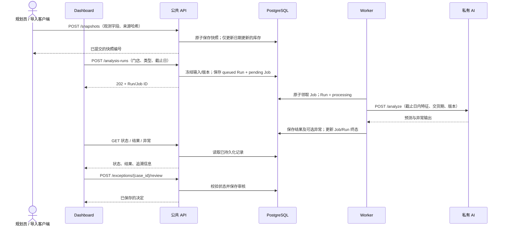

# W04 数据流核对与接口传输交接

核对日期：2026-10-20。依据用户提供的 [architecture.md](w04-reference/docs/architecture.md) 第 2、3、5、6、7、8、9 节和 [dataset-profile.md](w04-reference/docs/dataset-profile.md)。`w04-reference/` 保存原文副本，未改写提供的文档。

## 结论

原有 Dashboard 的公共 API 方向正确，但未完整实现前端传输合同；第一阶段补齐了请求、响应检查、展示和交接文档。**后续经用户授权，已连接 ai-model-v1，补充独立 SQLite、公共 API、独立 worker 和真实模型服务，完成本机全流程验证；2026-10-22 增加 PostgreSQL schema migration 和可配置后端。** 2026-10-21 整理为 main 更新版。最新实现、配置与尚未完成的数据库服务验收见[本地联调说明](local-integration-zh.md)。



数据库、worker、AI 箭头是 W04 指定的服务端职责，不在浏览器执行。离线训练单独产出模型制品，由私有 AI 加载；页面不发起训练、私有推理或采购。

## 检查发现与修改

| W04 要求 | 修改前 | 本次处理 |
| --- | --- | --- |
| Dashboard 只连接公共 API | 已做到 | 保留统一适配层；没有数据库、worker、AI 或采购调用。 |
| 上传/查询快照、单商品库存 | 缺少适配方法 | 新增 `ingestSnapshots`、`getSnapshots`、`getInventoryItem`。库存页新增“每日快照传输”。 |
| 门店隔离 | 异常列表漏传门店 | 库存、快照、异常列表传 S001，响应也检查门店，拒绝跨门店数据。 |
| 原始字段与来源留存 | 无上传合同 | 保留原始类别/地区/折扣等字段，携带原文件 SHA-256 和行来源；请求白名单排除模型/派生字段。 |
| Demand Forecast 仅离线参考 | 未定义上传 | 仅以 benchmark 存入快照，允许负值；分析请求不传 benchmark、特征或预测结果。服务端仍须实施特征白名单。 |
| 创建 Run + Job 返回 202 | 未检查 202、Job 状态；页面忽略 Job | 检查 202、queued/pending；状态查询带 Job，页面显示 ID/状态，日志链接携带 Run/Job。 |
| W04 示例使用数字 ID | 校验只接受字符串 | 将安全整数资源 ID 转为字符串，不强转数量、价格、预测值。超大 ID 必须由服务端输出字符串。 |
| 查询持久化结果，包括正常商品 | 已做到 | 保留正常结果；增加 Run/结果两次读取的状态和计数一致性检查。 |
| 无效预测不得当零需求 | 部分必要预测值可缺失 | 分模式检查必需值，拒绝缺失值、错误类型、P90 < P50、模式混用；不补零、不重算推荐量。 |
| 结果可追溯 | 缺少来源快照和耗时校验 | 检查并展示 snapshot_id、版本、输入来源、processed_at、duration_ms。 |
| 三种异常类型 | 只接受 reorder/anomaly | 支持 `reorder_and_anomaly`；组合案例必须有兼顾异常与补货的说明。 |
| 审核动作的数量语义 | 所有动作都传表单数量 | approve 省略；modify 传修改值；reject 传 0；resolve 传 null。 |
| 审核不改库存、不采购 | 已做到 | 只写审核端点，成功后重读案例；快照提交后重查库存，不在页面计算库存增减。 |
| 失败/部分结果/重试清晰 | 有错误处理，部分响应检查较宽松 | 失败/部分任务禁止审核；不一致响应报错；写入不自动重试，结果不确定时阻止重复提交。 |
| 旧演示记录兼容 | 已有本地记录 | 新任务增加 fixture_version；保留旧案例类型和已保存决定。 |

## 传输合同

路由名称遵循 W04。原文没有逐字段指定所有 JSON 包装，以下为本次**联调细化合同**，须后端实现或在 `live-api.js` 集中适配：100 行批次上限、SHA-256 字段、快照请求/回执包装、日期参数 `from/to`、状态中的 `job` 对象。它们不代表团队已确认或后端已实现。

| 方法 | 公共端点与传输 |
| --- | --- |
| `ingestSnapshots(body)` | `POST /snapshots`，body `{source_file_sha256,snapshots:[...]}`。成功 HTTP 200/201，回 `{inserted_count,snapshot_ids:[...]}`。 |
| `getSnapshots(filters)` | `GET /snapshots?store_id=S001&product_id=...&from=YYYY-MM-DD&to=YYYY-MM-DD`；商品/日期可省略、日期含边界；回完整快照数组。 |
| `getInventory(filters)` | `GET /inventory?store_id=S001`，回当前库存数组。 |
| `getInventoryItem(store,product)` | `GET /inventory/{store_id}/{product_id}`，回一条当前库存。 |
| `createAnalysisRun(body)` | `POST /analysis-runs`，只传 `{store_id,run_type:"daily",as_of_date}`；回 202 及 queued Run、pending Job。Monthly 尚不支持。 |
| `getAnalysisRun(id)` | `GET /analysis-runs/{run_id}`，回状态、Job、日期、计数、partial、时间和安全错误摘要。 |
| `getAnalysisResults(id)` | `GET /analysis-runs/{run_id}/results`，回 `{status,partial,results:[...]}`，包含正常商品。 |
| `getExceptions(filters)` | `GET /exceptions?store_id=S001&run_id=...&status=...`，回带父 Run 和结果的案例数组。 |
| `getException(id)` | `GET /exceptions/{case_id}`，回完整案例。 |
| `submitReview(id,body)` | `POST /exceptions/{case_id}/review`，回已保存的完整案例。 |

当前列表合同要求完整匹配数组，不能悄悄只返回第一页。历史查询可先限定商品/日期；数据量增大时共同补充有总量/游标的分页合同。健康检查和 metrics 是服务端运维端点，不参与页面计算预测。日志端点另见 [后端日志合同](backend-logs-contract.md)。

### 快照

每批为同一来源文件的 1–100 条记录。`source_file_sha256` 是**原文件字节**的 64 位十六进制 SHA-256，由导入客户端计算。每条 `source_reference` 标明文件和原始行号；不可用演示哈希冒充真实文件哈希。

```text
store_id, product_id, snapshot_date,
category_raw, region_raw, inventory_level, units_sold, units_ordered,
price, discount_raw, weather_condition, holiday_promotion,
competitor_pricing, seasonality_raw, demand_forecast_benchmark,
source_reference
```

字段映射见原始 dataset-profile。日期转换成 YYYY-MM-DD；数量、价格、折扣非负有限，holiday_promotion 为 0/1，benchmark 允许负数。不在前端将原始 Category/Region 固化为主属性。

库存页接受映射好的 JSON；**本次没有开发整份 CSV 自动导入器**。数据同学也可直接调用同一公共接口。

API 必须先验证整批，再原子写快照及库存。任一重复/无效记录使整批失败，返回 409/422；成功回执条数须与输入一致，snapshot_ids 按输入顺序列出全部已提交记录。原文件哈希和行来源要实际持久化。

库存只采用更近业务日期的观测值，旧日期回填不能回滚当前值；不能再加 Units Ordered 或减 Units Sold。多批文件仅保证每批原子性，已提交前批不因后批失败回滚。分析前的截止日完整商品覆盖仍由服务端检查。

GET 快照记录含上述字段及 id；当前库存含 `product_id,store_id,on_hand_quantity,snapshot_date,source_snapshot_id,lead_time_days`，name/category 可选。页面展示服务端交货期，不根据显示类别自行计算。

### 状态与结果

创建响应沿用 W04 示例：

```json
{"analysis_run":{"id":101,"status":"queued"},"job":{"id":501,"status":"pending"}}
```

状态响应要求 `id,store_id,as_of_date,status,job:{id,status},processed_count,expected_count,partial,created_at,completed_at`；可带顶层 error 安全摘要，详细栈走后端日志。

Run/Job 配对为 queued/pending、processing/claimed、completed/completed、failed/failed。页面通过状态端点恢复 Job，不猜编号。模型、策略、输入与来源快照随每条结果返回；quantile 必须有 P50/P90，point_buffer 必须有 point/buffer 且 P50/P90 为 null/省略。

结果状态/条数与 Run 一致；成功空结果合法，失败空结果仍是失败。部分已提交结果保留可查，未完成任务不可审核。具体 DTO 见 [前端合同](frontend-api-contract.md)。

### 审核

父 Run 必须 completed、非 partial，案例必须 pending_review。后端必须条件更新保证并发只成功一次，重复审核返回 409，不能只依赖按钮禁用。

| 动作 | 请求数量 | 要求 |
| --- | --- | --- |
| approve | 省略 | 服务端使用原建议；组合案例必须有说明。 |
| modify | 非负整数 | 数量、原因、审核人必填。 |
| reject | 0 | 原因、审核人必填。 |
| resolve | null | 仅 anomaly；说明、审核人必填。 |

前端核对返回的决定、审核人、原因和修改数量，随后重新读取案例。reviewer_label 是演示标签，不等于登录认证。写入失败不自动重试；超时/不确定响应须先查询服务器记录。

## 服务端职责（前端阶段交接清单）

以下为最初交接时的待办；目前第 2–6 项核心流程及第 1 项公共端点/本地事务已有 SQLite 联调实现，PostgreSQL 版本化 SQL migration 已加入代码，但需在团队数据库服务上执行集成验收。部署认证和失效任务恢复仍待团队交付；SQLite 本机测试不等于 PostgreSQL 运行验证。

1. W04 表、迁移、约束、事务和真实公共端点，以及 CORS/代理。
2. Daily 商品选择、截止日覆盖检查、冻结快照清单及模型/特征/策略版本；只使用 cutoff 以前历史。
3. 原子创建 Run/Job 和 worker 领取、状态推进、重启持久化。
4. worker → 私有 `/analyze`，核对身份、日期、lead_time_days 和版本；排除 benchmark 与未来信息。
5. worker 执行 W04 补货规则，保存正常结果、异常与追溯信息；AI 不写库存和审核。
6. 审核事务、完整日志和失败部分结果；v1 不承诺自动重试，后续实现有界重试/失效领取恢复。

Zhou 本次负责公共请求封装、页面消费/展示、校验和联调证据，不等于独自承担数据库、worker、模型。

## 验证与交接验收

自动化测试覆盖路径/字段、数字 ID、202、状态组合、门店日期隔离、来源、预测模式、三种异常、审核数量、错误回执、不自动重试和旧记录兼容。临时本机 HTTP 服务验证“快照 → 库存 → 创建 → 状态 → 结果 → 异常 → 审核 → 回读”，检查没有私有 AI 或采购调用。

以上为前端和受控 HTTP 合同测试。真实后端就绪后另按 W04 第 9 节取得数据库记录、迁移版本、并发领取/审核、历史回填、防泄漏、实际 Run/Job/模型版本、重启回读及关联日志证据。

2026-10-20 本地结果：`node --test frontend/tests/*.test.js` 共 32 项通过，Vite 生产构建通过。浏览器确认商品快照过滤、Run/Job 展示、组合异常审核及刷新回读，未发现控制台错误。测试新增模拟 Run `d89e9b60-ede2-408e-a266-67737a82d39a`，P0003 审核标签为“接口联调测试”；该记录仅在本地浏览器中，绝非真实后端运行证据。原文副本四个文件均与用户提供的文件 SHA-256 一致。
