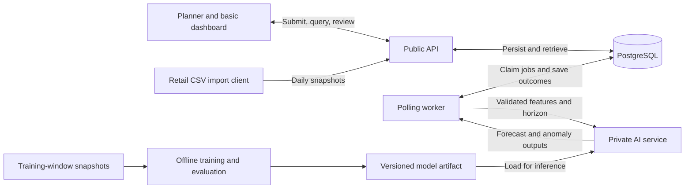
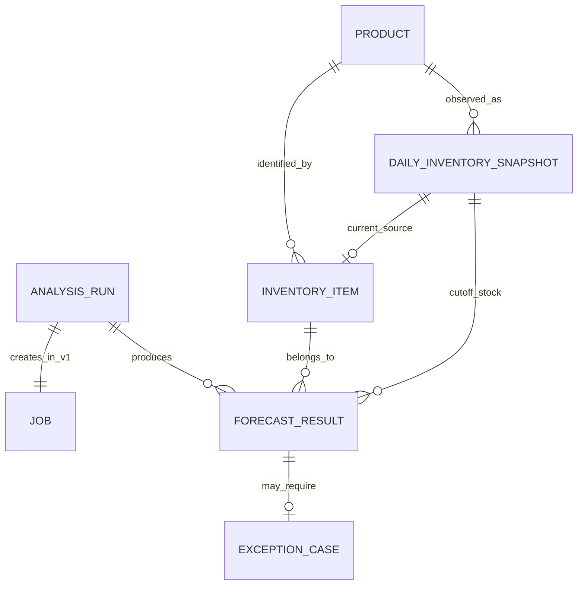
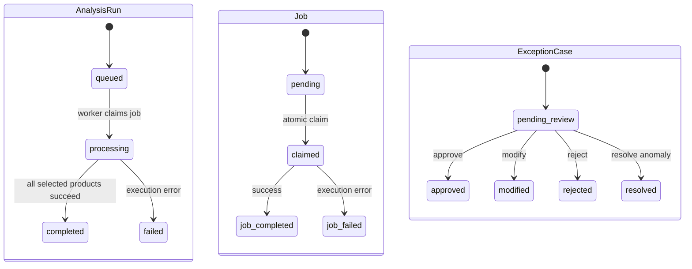

# Project F.I.X. Architecture

Project F.I.X. (Forecasting & Inventory Exceptions) converts daily retail snapshots into persisted forecasts, inventory recommendations, and reviewable exceptions. The [submission summary](../submissions/week04/README.md) contains the project plan; the [dataset profile](dataset-profile.md) records the data checks underlying this design.

## 1 Problem and Primary User

Inventory planners and analysts need to identify replenishment needs and unusual sales or stock conditions without manually reviewing every product every day. The system prioritizes exceptions and makes each recommendation traceable to a store-product snapshot, input history, model, policy, and human decision.

The business motivation is multi-store retail, but v1 controls **one selected store**. S001 is the proposed demonstration store, not a claim that the source has only one store. We shall keep `store_id` in records and API requests to prevent accidental mixing of series. Cross-store optimization and warehouse transfers remain outside scope.

The source is `retail_store_inventory_data.csv`, with 73,100 daily records spanning five stores and 20 products. `Units Sold` is realized sales used as the demand proxy; `Inventory Level` is reported stock; `Units Ordered` is an observed ordering signal, not confirmed receipts. Supplier lead times are simulated. The CSV's `Demand Forecast` is an offline reference only. Forecast accuracy and business benefit must be evaluated rather than assumed.

## 2 Primary Workflow

1. **Submit snapshots.** A planner or import client supplies daily records for the configured store, with store/product/date, inventory, sales, ordering, and contextual fields.
2. **Validate and persist.** The API validates identity, date, required fields, and field-specific ranges. It inserts `DailyInventorySnapshot` and refreshes InventoryItem atomically. Duplicate keys are handled explicitly.
3. **Trigger analysis.** The planner sends `store_id`, `run_type`, and `as_of_date`. The API verifies snapshot coverage and freezes the run's input references and policy/model versions.
4. **Create durable work.** The API commits a queued `AnalysisRun` and pending `Job` together, returning `202 Accepted` and both identifiers without waiting for inference.
5. **Prepare features.** A worker claims the job atomically, marks the run processing, and builds Product × Day features within the selected store and frozen cutoff.
6. **Call AI.** The private service returns cumulative lead-time sales forecasts and anomaly outputs. The worker validates identity, horizon, values, and version metadata.
7. **Persist outcomes.** The worker calculates safety stock and recommended quantity, then saves ForecastResult and an optional ExceptionCase together. Normal results remain queryable.
8. **Review exceptions.** The planner uses the public API or basic dashboard to approve, modify, reject, or resolve a case. The decision, reviewed quantity where relevant, reason, reviewer, and timestamp are persisted.

Forecasting and review do not mutate stock or submit purchase orders. Stock changes only when a validated newer daily snapshot is ingested. Ingestion sets the observed stock value; it does not add Units Ordered or subtract Units Sold again.

### Daily and Monthly selection

| Property | Daily core | Monthly extension |
| --- | --- | --- |
| Scope | Selected store only | Selected store only |
| Selection | Products with `units_sold > 0` or an Inventory Level change on the cutoff date | All inventory products at the cutoff |
| Purpose | Active-product replenishment and anomaly review | Coverage of inactive and zero-sales products |
| Forecast horizon | Product's simulated lead time | Same lead-time definition |
| Trigger | Manual API request | Manual API request after Daily is stable |

Inventory change compares the current snapshot with the immediately preceding calendar day's snapshot for that store-product. A proposed bootstrap rule includes a first snapshot as newly observed inventory; missing history is handled by the documented cold-start model policy. Missing intermediate days are data gaps, not zero sales. For v1, validate a complete cutoff-day snapshot set for the configured product roster before accepting a run. If the full set is present but no Daily product is eligible, complete with zero results.

Daily can miss zero-sales products whose stock has not changed. Monthly addresses this selection gap; it does not change the forecast horizon to one month. Coverage validation and selection rules are proposed clarifications of the new proposal's two Daily-selection descriptions.

## 3 Architecture and Boundaries



| Component | Responsibility |
| --- | --- |
| Public API | Validate snapshots; maintain the current inventory view; create runs/jobs; retrieve persisted outputs; enforce review transitions. No synchronous model inference. |
| Database | Persist observations, inventory, workflow states, forecasts, and reviews. Database constraints protect identity and uniqueness. |
| Polling worker | Claim work, reconstruct cutoff inputs, invoke AI, apply deterministic inventory policy, persist outcomes and failure states. |
| Private AI service | Load an existing versioned model and return validated prediction/anomaly outputs. No stock or review writes. |
| Offline training | Prepare temporal features/targets, compare against baselines, calibrate uncertainty, and publish a model artifact. No retraining on user requests. |
| Dashboard | Trigger runs, inspect status/results, and review cases through the API. No direct database access. |

This can be achieved by using the starter's API → database → worker structure with shared schemas, database sessions, configuration, health checks, and structured logging. Proposed persistence tooling remains SQLAlchemy and Alembic with PostgreSQL. Docker Compose runs API, database, worker, and private AI service; retain the database volume across restarts. Keep the AI endpoint internal to the service network.

Human review travels through the public API, not directly through the worker. Offline training produces the artifact loaded by the AI service. These directions are made explicit in the revised diagram.

## 4 Persistent Entities and ERD

Seven core tables replace the old trade-transaction schema. Product × Day remains a derived feature dataset. The following is the proposed schema, including data-driven refinements explained below.

| Entity | Keys and essential fields |
| --- | --- |
| Product | `id` PK, optional `display_name`, `created_at`.  |
| InventoryItem | Composite PK `(store_id, product_id)`; Product FK; `on_hand_quantity`, `snapshot_date`, `source_snapshot_id` FK, scenario `lead_time_days`, `policy_version`, `updated_at`. |
| DailyInventorySnapshot | `id` PK; `store_id`, `product_id` FK, `snapshot_date`, `category_raw`, `region_raw`, `inventory_level`, `units_sold`, `units_ordered`, `price`, `discount_raw`, `weather_condition`, `holiday_promotion`, `competitor_pricing`, `seasonality_raw`, signed `demand_forecast_benchmark`, `source_reference`, `created_at`. |
| AnalysisRun | `id` PK; `store_id`, `run_type`, `as_of_date`, `status`, `input_reference`, `model_version`, `policy_version`, `created_at`, `started_at`, `completed_at`. |
| Job | `id` PK; `analysis_run_id` unique FK in v1, `job_type`, `status`, `attempts`, `error`, `created_at`, `claimed_at`, `completed_at`. |
| ForecastResult | `id` PK; `analysis_run_id`, `store_id`, `product_id`; run/store and inventory-item FKs; `snapshot_id` FK, `horizon_days`, `forecast_mode`, nullable P50/P90 and point/buffer fields, `inventory_at_prediction`, `safety_stock`, `recommended_order_quantity`, anomaly score/type/severity/threshold and triggered reasons, `explanation`, `model_version`, `input_reference`, `policy_version`, `processed_at`, `duration_ms`. |
| ExceptionCase | `id` PK; unique `forecast_result_id` FK; `exception_type`, `status`, `reviewer_decision`, nullable `reviewer_order_quantity`, `reviewer_label`, `override_reason`, `reviewed_at`, `created_at`. |

Product stores identity; InventoryItem stores the latest observed state for a store-product. Category is preserved on snapshots because the source changes Category for the same product. A versioned policy artifact stores the frozen scenario category and lead-time mapping rather than treating Category as a reliable immutable Product attribute. Region is also retained at snapshot level.

Computed safety stock belongs to ForecastResult. It is not an observed CSV field and is not a second authoritative stock quantity in InventoryItem. The latest value can be retrieved from the latest applicable completed result.



Each run has one job in v1. Each result belongs to one run and one store-product; a result has zero or one case. Normal predictions need no review. Multiple anomaly reasons may be stored in one result and summarized in one case. A separate review-event table is deferred until reopening or multiple review events are required.

### Integrity and Migration Decisions

- Enforce `UNIQUE(store_id, product_id, snapshot_date)` on snapshots, `UNIQUE(analysis_run_id, store_id, product_id)` on results, and `UNIQUE(forecast_result_id)` on cases.
- Add `UNIQUE(id, store_id)` on AnalysisRun and a composite FK `(analysis_run_id, store_id)` from ForecastResult. Reference InventoryItem by `(store_id, product_id)`. Validate that `snapshot_id` matches the result's store/product/date; enforce via a composite snapshot reference or equivalent database constraint.
- There is no Store table in the seven-table v1. `store_id` is a validated configured identifier, **not** an FK to an absent table. A Store dimension is a later schema extension if multi-store operation is authorized.
- Use exact numeric fields for quantities/prices, nonnegative checks for stock/sales/orders/prices, positive integer lead times, finite values, and binary promotion flags. Preserve raw discount units pending a data dictionary. The benchmark field permits signed finite numbers because the source contains negative forecasts.
- Create indexes supporting snapshots by store/product/date, pending-job claims, results by run, and cases by status. Use Alembic migrations for these changes; do not claim an applied migration at Week 4.
- Constrain all states and review actions to the canonical values in Section 5. Model name/version and numeric precision remain implementation choices to confirm before migration.

### Atomic Ingestion and the Current View

For a single snapshot, validate and insert the observation and update InventoryItem in one database transaction, serializing updates for that store-product. Update the current view only if the incoming business `snapshot_date` is newer. Historical backfills remain queryable but cannot roll the current view backward. Create a product and its initial inventory record atomically on first accepted ingestion.

Use a small batch as the proposed `/snapshots` request unit; validate all rows and commit all-or-nothing. A duplicate business key returns `409` without applying any of that batch. Retain a file hash and row/source reference for provenance. Record corrections require an explicit future versioning mechanism; v1 does not silently overwrite existing snapshots.

### Historical Runs and Frozen Inputs

For a run at date `t`, query DailyInventorySnapshot at `t` and history up to `t`, it does not read today's InventoryItem balance for an older run. Later snapshots may exist and must be ignored, not used as a reason to reject an otherwise valid historical request. `updated_at` is ingestion time and must not be compared with a business-date cutoff.

Freeze input IDs/source hashes at run creation, plus model, feature and policy versions. `input_reference` points to an immutable retained manifest of those IDs and configuration. Later backfills do not enter an existing run. A hash alone is not sufficient unless its underlying data remain available. Persist the exact cutoff snapshot and lead time on each result.

## 5 State transitions and review semantics



The Job diagram's `job_completed`/`job_failed` labels represent stored values `completed`/`failed`. Run values are `queued`, `processing`, `completed`, `failed`; Job values are `pending`, `claimed`, `completed`, `failed`. Do not also introduce `running` or `succeeded`. The API creates runs/jobs and records reviews; the worker advances processing states. Completing computation does not mean the planner has completed review.

The **workflow category** is separated from **risk reason** to reconcile the proposal's two exception vocabularies. `ExceptionCase.exception_type` is `reorder`, `anomaly`, or `reorder_and_anomaly`. ForecastResult stores risk reasons such as `stockout_risk`, `overstock_risk`, and `unusual_demand`. This permits several reasons without creating multiple cases for one result.

Create a case when recommended quantity is positive or numeric anomaly severity meets the persisted policy threshold. The worker uses versioned deterministic rules for v1 severity; all threshold values must be explicit in the deployed policy.

| Review action | Resulting state and constraints |
| --- | --- |
| `approve` | `approved`; accept the recommended quantity for a case containing reorder. |
| `modify` | `modified`; require a nonnegative reviewed quantity and reason for a case containing reorder. |
| `reject` | `rejected`; require a reason and record zero accepted quantity for a case containing reorder. |
| `resolve` | `resolved`; close an anomaly-only case with a review note and no order quantity. |

For combined cases, the review note addresses the anomaly as well as replenishment. Persist reviewer identity/label and review time. Use a conditional update from `pending_review`; repeated or invalid transitions return `409`. Proposed v1 guard: only cases from completed runs can be finalized. Failed-run partial results remain inspectable with their failure context. Review records an advisory decision; no external purchasing API is called.

## 6 API and service contracts

These are proposed routes. Results are served from persisted records, not recomputed during retrieval.

| Method and route | Purpose |
| --- | --- |
| `POST /snapshots` | Validate and atomically ingest a bounded batch; refresh current inventory only for newer snapshots. |
| `GET /snapshots` | List snapshots by store, product, and date range. |
| `GET /inventory?store_id=S001` | List current inventory for the configured store. |
| `GET /inventory/{store_id}/{product_id}` | Retrieve one current inventory record and its business snapshot date. |
| `POST /analysis-runs` | Create a Daily or supported Monthly run and pending Job; return `202`. |
| `GET /analysis-runs/{run_id}` | Return status, timestamps, job error, processed counts, and partial-result flag. |
| `GET /analysis-runs/{run_id}/results` | Return persisted results and run completeness. |
| `GET /exceptions` | List cases with store/status filters and parent-run context. |
| `GET /exceptions/{case_id}` | Retrieve a case with its supporting result and snapshot references. |
| `POST /exceptions/{case_id}/review` | Validate and persist a review action. |
| `GET /health/live` | Process liveness. |
| `GET /health/ready` | Required dependency/model readiness for the relevant service. |
| `GET /metrics` | Queue depth, processing duration, and failure counts. |

```http
POST /analysis-runs
Content-Type: application/json

{"store_id":"S001","run_type":"daily","as_of_date":"2022-06-30"}
```

```json
{
  "analysis_run": {"id": 101, "status": "queued"},
  "job": {"id": 501, "status": "pending"}
}
```

The example date exists in the supplied CSV. A model trained with targets ending before the request cutoff shall be used for an honest historical demo. Return `422` for invalid fields, unsupported stores/types, or insufficient required coverage; `404` for missing requested resources; and `409` for duplicate snapshot keys or invalid review states. Monthly requests are rejected as unsupported until its implementation is available, rather than silently treated as Daily.

Private `POST /analyze` input includes store/product identity, `as_of_date`, `lead_time_days`, feature vector/history, `input_reference`, and expected model version. Output echoes identity and horizon and includes `forecast_mode`, forecast values, anomaly score/type, and actual model version. Validate finite nonnegative forecast values, P90 ≥ P50 in quantile mode, matching horizon/identity/version, and the documented anomaly-score range. Invalid model output is a processing error, never a zero-demand default.

## 7 Worker and AI processing plan

### Durable Execution

Atomically claim a pending Job, confirm its parent run is queued, and transition the run to processing. Commit the claim before making a network inference call; do not hold a database transaction open during model execution. Concurrent workers cannot own the same job.

For each selected product, retrieve frozen cutoff observations, prepare features, call AI, calculate the recommendation, and commit ForecastResult plus optional ExceptionCase atomically. Enforce uniqueness in the database, not only with an application check. Update final Job and AnalysisRun status together after every selected product succeeds.

### Inventory and Lead-time Assumptions

Treat the supplied Inventory Level as stock available at the analysis cutoff. Its start/end-of-day meaning is undocumented. Adopt a stated end-of-day analysis convention: date `t` sales/context have been ingested, and the forecast target begins on `t+1`. This convention supports a simulation but does not establish the source's actual measurement timing.

The lead times are:

| Scenario category | Lead time in days |
| --- | ---: |
| Groceries | 3 |
| Toys | 7 |
| Clothing | 10 |
| Electronics | 14 |
| Furniture | 21 |

Because Category changes within each product series, the proposed refinement is a modal category per product using only the selected store's training window, with alphabetical tie-breaking. Freeze the assignments in the policy artifact. For a product without a recognized training category, we plan to use the median lead time of recognized products in that training window, rounded up to a whole day; if none exist, use 10 days, the median of the five scenario values. 

### Features and Leakage Controls

We plan to train one pooled/global model across products for the selected store, derive lagged sales at 1, 7, 14, and 28 days, rolling mean/median/standard deviation over 7/14/28 days, and calendar features. Rolling features must use only data available at the feature cutoff. Cold-start handling must be defined in the model artifact; missing history must not be silently relabeled as zero sales.

Historical price, discount, competitor price, promotion, weather, and Units Ordered are candidate covariates, subject to known availability. V1 may start with sales history and calendar features, adding others only if validation improves. Preserve raw category/region/seasonality fields, but exclude unstable Region and source Seasonality initially. A frozen scenario category can be used as an explicitly synthetic attribute. Actual future  weather, price, promotion, orders, or stock as if known at prediction time shall not be used. Future calendar features are available; future planned covariates require explicit scenario inputs.

`demand_forecast_benchmark` is excluded by a feature allowlist from all training/inference inputs, targets, and uncertainty calibration. Its source provenance and forecast origin are unknown. Offline comparison is descriptive until those properties can be verified.

### Target and Replenishment rule

For product `i` and cutoff `t`, predict total Units Sold from `t+1` through `t+L_i`. Use only training examples with fully observed target horizons. P50/P90 refer to quantiles of that cumulative total; do not add daily quantiles and call the result a horizon quantile.

```text
safety_stock = max(0, P90 - P50)
recommended_order_quantity = ceil(max(0, P90 - inventory_at_prediction))
```

The rounding rule is a proposed whole-unit retail convention. For P50 = 240, P90 = 310, and stock = 180, safety stock is 70 and recommended quantity is 130. The simplified policy ignores open orders and reserved stock because the source does not supply them. Units Ordered is not subtracted as known inbound inventory.

If quantiles are not feasible, use `forecast_mode=point_buffer`, a labeled point forecast, and a nonnegative buffer from the 90th percentile of signed out-of-sample horizon errors. Persist `predicted_demand_point` and `uncertainty_buffer`, leave P50/P90 null, and compute `ceil(max(0, point + buffer - stock))`. The fallback safety stock is that buffer. Never relabel a mean or arbitrary point estimate as P50. Freeze the forecast mode and calibration method in the model artifact before integration.

Start anomaly handling with versioned rules for unusually high sales and stock shortfall; overstock/slow-moving rules are optional after Daily works. Explanations use templates populated with horizon, stock, predicted sales, triggered rule, and recommendation. No generative language model is required at runtime.

### Evaluation and traceability

Use chronological train/validation/test periods with training target windows ending before the next split. Select scenario categories and preprocessing parameters from training only. Compare pooled predictions with cutoff-safe naive and rolling-rate baselines. Report MAE for cumulative sales; evaluate quantile coverage/pinball loss when quantiles are produced. Keep final test data untouched by model/threshold tuning.

The source forecast can be reported as an unverified reference, not as a confirmed out-of-sample baseline. If future daily source forecasts are summed for a horizon, label that total retrospective because its availability at `t` is unknown. Preserve negative source values and disclose any separate clipping policy used for a derived comparison.

Store model, feature, policy, and input versions with processing duration. Retain at least the Week 7 artifact and final artifact so earlier results remain explainable. Business-impact claims require evidence beyond this dataset's forecasting metrics.

## 8 Failure retries and observability

| Situation | Initial behavior | Later reliability work |
| --- | --- | --- |
| Invalid/duplicate snapshot | Reject batch with field/key details; no partial inventory update. | Import reports and explicit correction/versioning workflow. |
| Missing snapshot coverage | Reject before run creation with missing product/date details. | Explicit stale-data policies if needed. |
| AI error or invalid response | Record error; mark job/run failed; never fabricate a successful output. | Bounded transient-error retries and measured timeouts. |
| Error after some product commits | Retain partial outputs; show failed run and processed/expected counts. | Resume only unfinished products. |
| Worker crash after claim | Durable record remains claimed/processing and needs operator inspection. | Lease/heartbeat and safe stale-claim recovery. |
| Repeated processing | Atomic claims and result/case uniqueness prevent duplicate writes. | Idempotent retries preserving versions and reviews. |

v1 makes failure visible and permits a deliberate new run; it does not promise automatic retry. A new run may surface the same condition again. Cross-run suppression and grouping are deferred. A future retry must reuse completed results and never overwrite human review; recovery must prevent an old worker from committing after a replacement claims ownership.

Structured logs include run, job, store, and product IDs where relevant. Events include `job_claimed`, `forecast_completed`, `exception_created`, and `review_completed`. Expose safe error summaries through the API, with detailed diagnostics in operational logs. Initial signals are health, queue depth, duration, and failures. Do not dump credentials or complete input records into logs.


## 9 Persistence evidence and acceptance plan

The [dataset profile](dataset-profile.md) is completed evidence about the supplied data. The following are planned application checks; no migration execution, database persistence test, or deployed model result is claimed at this checkpoint.

| Check | Evidence to capture |
| --- | --- |
| Snapshot persistence | Valid snapshot and InventoryItem commit together; invalid/duplicate batch leaves both unchanged. |
| Historical correctness | Backfill does not roll current inventory backward; a past run uses its dated snapshot even when newer snapshots exist. |
| Store isolation | Wrong-store requests fail; no features/results combine stores. |
| Durable work | Trigger response IDs correspond to committed queued/pending records; two workers cannot own the same job. |
| AI traceability | Persist input reference, snapshot ID, model/policy versions, horizon, and timing; confirm source Demand Forecast is absent from the feature payload. |
| Results and review | At least one normal result creates no case; one valid case is approved or modified and remains retrievable. |
| Failure | Inject service failure; verify visible failed states and honest partial-output labeling. |
| Restart | Restart API/worker with database volume retained; retrieve previously committed observations, forecasts, and review decisions. |
| Migration | Apply the seven-table migration on an empty database; verify uniqueness, FKs, checks, and indexes. |

We plan to use curated labeled fixtures when the dataset does not naturally exercise a required case, without passing synthetic fixtures off as original rows. Save real run IDs, migration revision, database/API outputs, health response, and correlated logs after implementation.  

## 10 Keep Adapt Add and Risk Conclusions

| Category | Design conclusion |
| --- | --- |
| Keep | Starter API/database/worker pattern, schemas, migrations, health, configuration, and logging. |
| Adapt | Replace trade Transaction with DailyInventorySnapshot; replace generic input Case with AnalysisRun; use observed stock snapshots and category-based simulated lead times. |
| Add | Store-product-date uniqueness, source benchmark isolation, snapshot-based historical reads, retained category/region source fields, versioned scenario mapping, and final review persistence. |
| Risk | Source metadata instability, unclear stock timing, unverified forecast provenance, partial/stale jobs, and noisy alerts may undermine recommendations. |


## 11 Risks and scope cuts

| Risk | Mitigation |
| --- | --- |
| Weak forecasting signal | Test forecastability early; compare with temporal baselines and report limitations. |
| Category/region instability | Preserve raw fields; freeze training-only scenario categories; avoid treating Region as store identity. |
| Stock timing and sales censoring | State cutoff convention; forecast realized sales; avoid unsupported stockout/savings claims. |
| Unverified source Demand Forecast | Exclude from model inputs; disclose negative values and unknown forecast origin in comparisons. |
| Simulated lead times | Version assignments and fallback; test sensitivity. |
| Future information leakage | Freeze histories, fit training-only transforms, and enforce horizon-aware splits. |
| Inactive-product gaps/noisy alerts | Add Monthly scanning when stable; tune thresholds and later group repeated alerts. |
| Service failure or scope expansion | Protect visible durable processing and the Daily review path before optional features. |

**First scope cut:** automatic scheduling; retain manual API triggers. Next cut advanced dashboard features beyond a basic review queue, sophisticated anomaly models, and extra Monthly analytics. Protected scope includes one store, snapshot/current-inventory persistence, a pooled forecasting model, async inference, a simple anomaly rule, stored recommendations, and human review.

Automatic purchasing, cross-store optimization, multi-warehouse routing, supplier optimization, ERP integration, dynamic pricing/discount optimization, and complex role management are excluded.

Confirm the selected store, source units/provenance, day cutoff, category policy, forecast family/mode, thresholds, snapshot manifest format, and numerical timeout/retry settings before their implementation. 

